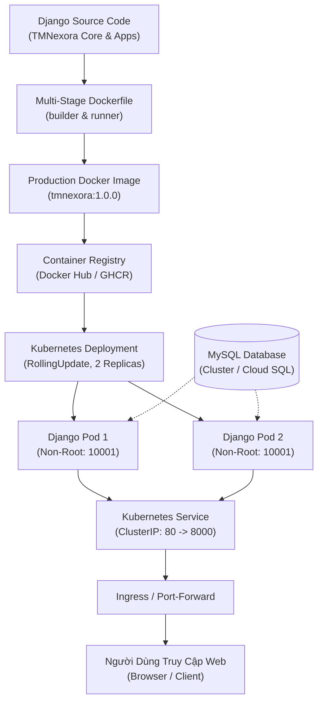

# TMNexora — Docker & Kubernetes Deployment Guide
**Enterprise Workforce & Employee Management System (EMS)**

Tài liệu hướng dẫn toàn diện về kiến trúc Container hóa (Docker) và Vận hành điều phối cụm (Kubernetes) cho hệ thống **TMNexora**, tuân thủ nghiêm ngặt các tiêu chuẩn Cloud-Native, Bảo mật Non-Root và Tối ưu hóa hiệu năng Production.

---

## 1. TỔNG QUAN KIẾN TRÚC TRIỂN KHAI (DEPLOYMENT ARCHITECTURE)

Hệ thống được đóng gói và vận hành theo mô hình phân lớp tiêu chuẩn:



---

## 2. KẾT QUẢ AUDIT DỰ ÁN (PROJECT AUDIT)

* **Framework & Phiên bản:** Django `5.0.8` chạy trên nền Python `3.12+`.
* **WSGI Production Server:** `Gunicorn 26.2.0` (3 workers, 2 threads, async graceful shutdown).
* **Quản lý Tài nguyên Tĩnh (Static Files):** `WhiteNoise 6.12.0` với `CompressedManifestStaticFilesStorage` nén gzip/brotli và gắn hash chống cache.
* **Cơ sở Dữ liệu:** Hỗ trợ kép `MySQL (InnoDB)` qua driver `PyMySQL 1.2.3` / `cryptography` và `SQLite3` (phục vụ test).
* **Bảo mật Container:** 
  - Image chạy dưới người dùng non-root `tmnexora` (UID/GID `10001`).
  - Drop toàn bộ Linux capabilities (`ALL`), ngăn ngừa leo thang đặc quyền (`allowPrivilegeEscalation: false`).
* **Health Probes:**
  - `GET /healthz/`: Startup & Liveness probe (kiểm tra tiến trình Web sống sót).
  - `GET /readyz/`: Readiness probe (thực thi `SELECT 1` kiểm tra kết nối Database trước khi điều hướng traffic).

---

## 3. DANH MỤC TÀI NGUYÊN ĐÃ XÂY DỰNG

| File / Thư mục | Loại tài nguyên | Mục đích sử dụng |
| :--- | :--- | :--- |
| `Dockerfile` | Docker Multi-Stage | Build image tối ưu dung lượng, tách biệt build tools khỏi runtime, non-root user. |
| `docker-entrypoint.sh` | Shell Script | Script điều phối khởi động container, hỗ trợ chờ DB và khởi chạy Gunicorn với PID 1. |
| `.dockerignore` | Cấu hình Docker | Loại bỏ `.git`, `.env`, virtualenv, cache, database file để giữ image sạch và an toàn. |
| `requirements.txt` | Quản lý Package | Khóa các phiên bản dependency chuẩn hóa cho môi trường container Linux. |
| `.env.example` | Template Cấu hình | Mẫu biến môi trường production sạch, không chứa secret thật. |
| `k8s/namespace.yaml` | K8s Namespace | Phân vùng tài nguyên độc lập `tmnexora`. |
| `k8s/configmap.yaml` | K8s ConfigMap | Cấu hình không nhạy cảm (Hosts, Ports, Worker count, Log level). |
| `k8s/secret.example.yaml` | K8s Secret | Mẫu khai báo Django Secret Key và thông tin kết nối CSDL. |
| `k8s/deployment.yaml` | K8s Deployment | Quản lý 2 Pods, RollingUpdate, Non-root securityContext, Resource requests/limits, Probes. |
| `k8s/service.yaml` | K8s Service | Cung cấp địa chỉ IP nội bộ ổn định (ClusterIP), map cổng 80 -> 8000. |
| `k8s/migrate-job.yaml` | K8s Batch Job | Chạy migration tách biệt, bảo đảm không bị chạy lặp trên các Pods. |
| `k8s/mysql-dev.yaml` | K8s Dev Database | Cung cấp MySQL trong cluster phục vụ kiểm thử cục bộ. |

---

## 4. QUY TRÌNH THỰC HIỆN BẰNG POWERSHELL (STEP-BY-STEP)

### Bước 1: Kiểm tra môi trường cục bộ
Mở PowerShell và kiểm tra công cụ:
```powershell
# 1. Kiểm tra phiên bản Docker
docker --version

# 2. Kiểm tra phiên bản Kubernetes client
kubectl version --client

# 3. Kiểm tra trạng thái Docker Daemon
docker info
```
> [!NOTE]
> Nếu xuất hiện thông báo `failed to connect to docker API`, hãy mở ứng dụng **Docker Desktop** trên Windows và chờ biểu tượng góc dưới chuyển sang màu xanh lá cây (*Docker Desktop is running*).

---

### Bước 2: Build và Kiểm tra Docker Image Cục bộ
```powershell
# Di chuyển vào thư mục dự án
cd "E:\Project\HeThongQuanLyNhanVien"

# Build production image với tag bất biến
docker build -t tmnexora:1.0.0 -t tmnexora:latest .

# Kiểm tra image đã tạo
docker images | Select-String "tmnexora"
```

Chạy thử nghiệm container độc lập trên máy:
```powershell
# Chạy container thử nghiệm cổng 8000
docker run -d --name tmnexora-test `
  -p 8000:8000 `
  -e DJANGO_DEBUG=False `
  -e DJANGO_SECRET_KEY="local-test-key-for-container-verification" `
  -e DJANGO_ALLOWED_HOSTS="*" `
  -e DB_ENGINE="django.db.backends.sqlite3" `
  -e DB_NAME=":memory:" `
  tmnexora:1.0.0

# Kiểm tra logs container
docker logs -f tmnexora-test

# Kiểm tra endpoint probes
curl -I http://127.0.0.1:8000/healthz/

# Dọn dẹp container thử nghiệm sau khi hoàn tất
docker stop tmnexora-test
docker rm tmnexora-test
```

---

### Bước 3: Triển khai Lên Cụm Kubernetes (K8s)

#### 1. Khởi tạo Namespace
```powershell
kubectl apply -f k8s/namespace.yaml
```

#### 2. Khởi tạo Secret và ConfigMap
Tạo file `k8s/secret.yaml` từ `k8s/secret.example.yaml` và áp dụng:
```powershell
Copy-Item "k8s/secret.example.yaml" "k8s/secret.yaml"
# Chỉnh sửa mật khẩu DB và Secret Key thực tế trong k8s/secret.yaml nếu cần
kubectl apply -f k8s/secret.yaml
kubectl apply -f k8s/configmap.yaml
```

#### 3. (Tùy chọn) Triển khai CSDL MySQL nội bộ trong K8s (Nếu test cục bộ)
```powershell
kubectl apply -f k8s/mysql-dev.yaml
# Chờ MySQL khởi động sẵn sàng
kubectl wait --for=condition=Ready pod -l component=mysql -n tmnexora --timeout=120s
```

#### 4. Chạy Database Migration Job
```powershell
kubectl apply -f k8s/migrate-job.yaml

# Theo dõi tiến trình Job chạy
kubectl get jobs -n tmnexora
kubectl logs -l component=migration -n tmnexora -f
```

#### 5. Triển khai Ứng dụng Web & Service
```powershell
kubectl apply -f k8s/deployment.yaml
kubectl apply -f k8s/service.yaml

# Theo dõi quá trình triển khai Rolling Update
kubectl rollout status deployment/tmnexora-web -n tmnexora
```

#### 6. Kiểm tra trạng thái toàn cụm
```powershell
kubectl get all -n tmnexora
```

---

### Bước 4: Truy cập Ứng dụng & Xác thực
Sử dụng tính năng Port-Forwarding để truy cập Service trong cluster từ trình duyệt:
```powershell
kubectl port-forward svc/tmnexora-service 8000:80 -n tmnexora
```
Mở trình duyệt truy cập:
👉 **`http://localhost:8000/`**

---

## 5. HƯỚNG DẪN QUẢN LÝ REGISTRY & TAGGING

Để đưa image lên Docker Hub hoặc Container Registry của doanh nghiệp:

```powershell
# 1. Đăng nhập Docker Registry an toàn (không lộ pass trên terminal)
docker login -u <username>

# 2. Gắn tag theo chuẩn Registry: <registry>/<repository>:<tag>
docker tag tmnexora:1.0.0 <username>/tmnexora:1.0.0
docker tag tmnexora:1.0.0 <username>/tmnexora:latest

# 3. Đẩy image lên Registry
docker push <username>/tmnexora:1.0.0
docker push <username>/tmnexora:latest
```

Sau khi push, cập nhật trường `image` trong `k8s/deployment.yaml` và `k8s/migrate-job.yaml` thành `<username>/tmnexora:1.0.0`.

---

## 6. GIÁM SÁT & XỬ LÝ LỖI (TROUBLESHOOTING)

### 1. Pod bị lỗi `CrashLoopBackOff`
* **Nguyên nhân:** Lỗi cú pháp cài đặt hoặc Gunicorn không thể import `config.wsgi`.
* **Cách kiểm tra:**
  ```powershell
  kubectl logs -n tmnexora <ten-pod> --previous
  ```

### 2. Pod bị lỗi `ImagePullBackOff` hoặc `ErrImagePull`
* **Nguyên nhân:** Tên image hoặc tag không tồn tại, hoặc chưa cấu hình `imagePullSecrets` khi dùng private registry.
* **Cách khắc phục:** 
  - Nếu test trên Minikube/Docker Desktop cục bộ, đảm bảo image `tmnexora:1.0.0` đã được nạp vào context của cluster (`minikube image load tmnexora:1.0.0` hoặc đặt `imagePullPolicy: IfNotPresent`).

### 3. Readiness Probe thất bại (`UNAVAILABLE`)
* **Nguyên nhân:** Pod không kết nối được tới Database (sai `DB_HOST`, sai cổng `3306` hoặc CSDL chưa cấp quyền truy cập).
* **Cách kiểm tra:**
  ```powershell
  kubectl describe pod -n tmnexora <ten-pod>
  # Kiểm tra kết nối từ bên trong Pod:
  kubectl exec -it -n tmnexora <ten-pod> -- python manage.py check
  ```

### 4. Lỗi `Invalid HTTP_HOST header` (DisallowedHost)
* **Nguyên nhân:** Domain hoặc IP truy cập chưa nằm trong `DJANGO_ALLOWED_HOSTS`.
* **Cách khắc phục:** Cập nhật biến `DJANGO_ALLOWED_HOSTS` trong `k8s/configmap.yaml` và chạy `kubectl rollout restart deployment/tmnexora-web -n tmnexora`.
