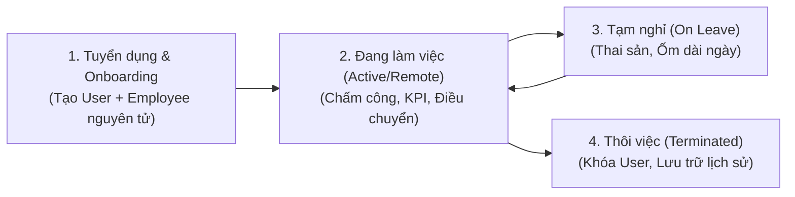

# PHÂN TÍCH NGHIỆP VỤ - EMPLOYEE MANAGEMENT SYSTEM (EMS)

Tài liệu phân tích nghiệp vụ toàn diện được xây dựng bám sát mã nguồn thực tế của dự án **Hệ Thống Quản Lý Nhân Sự (`HeThongQuanLyNhanVien`)** trên nền tảng **Django 5 (MVT) + FastAPI 2.0 (JWT REST API) + MySQL**.

---

## TỔNG QUAN & MỤC TIÊU ĐỀ TÀI (PROJECT OVERVIEW & OBJECTIVES)

### 1. Tên đề tài
**Hệ Thống Quản Lý Nhân Viên (Employee Management System - EMS)**

### 2. Lý do chọn đề tài & Bài toán thực tế (Problem Statement)
Trong các doanh nghiệp vừa và lớn, công tác quản trị nhân sự thường gặp phải các rào cản lớn:
- **Dữ liệu phân mảnh & thiếu tập trung:** Quản lý thông tin nhân sự rời rạc qua các file Excel hoặc hồ sơ giấy, gây nguy cơ thất lạc dữ liệu và khó khăn khi tra cứu lịch sử nhân sự.
- **Quy trình thủ công, dễ sai sót:** Chấm công, theo dõi ngày nghỉ phép và tính lương hàng tháng thường tốn nhiều công sức, dễ xảy ra tranh chấp hoặc tính toán sai lệch giữa giờ công thực tế, phụ cấp, tiền thưởng và thuế TNCN/bảo hiểm.
- **Thiếu tính minh bạch đối với nhân viên:** Nhân sự khó khăn trong việc chủ động theo dõi quỹ phép năm còn lại, lịch sử phiếu lương (Payslip) hoặc tiến độ phê duyệt đơn từ.
- **Khó khăn trong phân tích & ra quyết định:** Lãnh đạo doanh nghiệp (BOD, Ban Giám Đốc, HR Leader) thiếu cái nhìn trực quan, tức thời về biến động nhân sự, tỷ lệ đi làm và chi phí lương toàn công ty.

### 3. Mục tiêu của đề tài (Project Objectives)

#### A. Mục tiêu Tổng quát (General Objective)
Thiết kế và xây dựng một giải pháp phần mềm quản trị nguồn nhân lực **Hệ Thống Quản Lý Nhân Viên (EMS)** toàn diện, an toàn và tối ưu hóa cao, nhằm **số hóa 100% vòng đời nhân sự (Employee Lifecycle)** từ khâu tiếp nhận (Onboarding), quản lý hồ sơ, chấm công, phê duyệt nghỉ phép, tính lương tự động, đánh giá KPI đến xuất báo cáo quản trị.

#### B. Mục tiêu Cụ thể (Specific Objectives)
1. **Quản lý Dữ liệu Tập trung (Data Centralization):**
   - Thiết lập một nguồn chân lý dữ liệu đơn nhất (Single Source of Truth) quản lý toàn bộ cơ cấu phòng ban, chức danh chuyên môn và hồ sơ nhân viên trong doanh nghiệp.
   - Chuẩn hóa định biên nhân sự theo cấu trúc quản lý hiện đại: Hội đồng Quản trị, Ban Giám đốc, các phòng ban chuyên trách (Kỹ thuật & CNTT, Nhân sự, Tài chính, Sales, Marketing, R&D, Pháp chế, Hành chính).
2. **Tự động hóa Quy trình Nghiệp vụ (Workflow Automation):**
   - **Tự động hóa chấm công & kiểm soát ca làm việc:** Ghi nhận check-in/check-out thời gian thực, tự động phân loại tình trạng (đúng giờ, đi trễ, làm từ xa, vắng mặt).
   - **Số hóa quy trình duyệt phép 2 cấp:** Luồng duyệt tự động từ Leader trực tiếp (`Manager Approved`) chuyển tiếp sang Ban Nhân sự (`HR Approved`), kiểm soát chặt chẽ giới hạn 12 ngày phép năm và hồ sơ bệnh án đính kèm.
   - **Tự động hóa tính toán bảng lương (`Payroll Engine`):** Tự động liên kết công chấm công, giờ tăng ca, phụ cấp, thưởng KPI và các khoản khấu trừ (BHXH, Thuế TNCN) để xuất phiếu lương chính xác, chống gian lận.
3. **Phân quyền Bảo mật Đa tầng (Role-Based Access Control - RBAC):**
   - Phân chia quyền hạn nghiêm ngặt theo 4 vai trò: `Admin` (Quản trị hệ thống), `HR` (Quản lý nhân sự toàn công ty), `Manager` (Quản lý trực tiếp theo phòng ban), `Employee` (Cổng tự phục vụ cá nhân).
   - Đảm bảo tính riêng tư tuyệt đối: nhân viên chỉ được xem dữ liệu cá nhân của chính mình; quản lý chỉ được xem nhân sự trực thuộc ban của mình.
4. **Tối ưu hóa Trải nghiệm Người dùng & Tìm kiếm Thông minh:**
   - Xây dựng giao diện công thái học hỗ trợ Dark/Light Mode, phím tắt Command Palette (`Ctrl + K`).
   - Tích hợp công cụ tìm kiếm tức thì đa luồng (0ms latency, xử lý tiếng Việt không dấu) giúp tra cứu nhanh bất kỳ thông tin nhân sự, phòng ban hay phân hệ nào trong tích tắc.
5. **Kiến trúc Kỹ thuật Độc lập & Mở rộng (Hybrid Architecture):**
   - Kết hợp mô hình **Django 5 (MVT / SSR)** phục vụ cổng quản trị Web nội bộ ổn định, bảo mật với **FastAPI 2.0 (RESTful API, Swagger UI `/docs`, JWT)** sẵn sàng tích hợp với Mobile App, máy chấm công hoặc hệ thống bên thứ ba.
   - Tích hợp nền tảng tự động hóa **n8n Webhook** để đẩy thông báo đa kênh (Email doanh nghiệp, tin nhắn tức thời).

### 4. Kết quả Dự kiến của Đề tài (Expected Outcomes & Deliverables)

#### A. Sản phẩm Bàn giao Thực tế (Deliverables)
1. **Ứng dụng Web hoàn chỉnh (Full-stack Web Application):** Hệ thống phần mềm web chạy ổn định trên nền tảng Django 5 (MVT) + CSS/JS hiện đại, hỗ trợ Responsive trên Desktop/Tablet/Mobile và giao diện Sáng/Tối (Dark/Light Mode).
2. **Hệ thống RESTful API chuẩn hóa (FastAPI Service):** Cổng API độc lập chạy song song trên cổng 8001, tích hợp tài liệu tương tác tự động Swagger UI (`/docs`), xác thực bảo mật JWT Bearer Token, hỗ trợ truy vết lỗi qua Header `X-Request-ID`.
3. **Cơ sở dữ liệu quan hệ chuẩn hóa (Relational Database):** Lược đồ CSDL MySQL được thiết kế chuẩn hóa (3NF) gồm đầy đủ các bảng dữ liệu: Tài khoản (`User`), Hồ sơ nhân viên (`Employee`), Phòng ban (`Department`), Chức vụ (`Position`), Chấm công (`Attendance`), Nghỉ phép (`LeaveRequest`), Bảng lương (`Payroll`), Đánh giá hiệu suất (`PerformanceReview`) và Thông báo (`Notification`).
4. **Bộ Tài liệu Kỹ thuật & Báo cáo Nghiệp vụ:** Bao gồm tài liệu Phân tích nghiệp vụ chi tiết (`PHAN_TICH_NGHIEP_VU_EMS.md`), sơ đồ quan hệ thực thể (ERD), ma trận phân quyền RBAC và hướng dẫn triển khai/vận hành hệ thống.

#### B. Kết quả Đạt được về Mặt Nghiệp vụ & Vận hành (Functional Outcomes)
1. **Số hóa 100% hồ sơ nhân sự:** Quản lý tập trung thông tin cá nhân, hợp đồng, chức danh và lịch sử công tác của toàn bộ nhân viên; tự động sinh mã định danh theo chuẩn phòng ban (`KTxxxx`, `HRxxxx`, `0001`...).
2. **Quy trình chấm công & quản lý ca làm việc chính xác:** Tự động ghi nhận giờ vào/ra, tính toán chính xác ngày công chuẩn, giờ làm thêm (Overtime) và số lần đi trễ/về sớm.
3. **Quy trình phê duyệt nghỉ phép 2 cấp khép kín:** Vận hành luồng xét duyệt tự động từ Quản lý trực tiếp (`Manager`) đến Ban Nhân sự (`HR`), tự động đối soát quỹ 12 ngày phép năm và hồ sơ bệnh án đính kèm.
4. **Tính lương tự động, không sai sót:** Bộ máy tính lương (`Payroll Engine`) tự động tổng hợp công, thưởng KPI, phụ cấp và các khoản khấu trừ (BHXH, Thuế TNCN) để xuất phiếu lương chi tiết cho từng nhân sự.
5. **Đánh giá hiệu suất minh bạch (KPI Review):** Quản lý định kỳ đánh giá năng lực nhân viên theo thang điểm 1-5 sao, cung cấp dữ liệu đầu vào khách quan cho việc xét thưởng và thăng tiến.
6. **Công cụ tra cứu thông minh (Universal Search):** Hỗ trợ tìm kiếm tức thì toàn hệ thống (`Ctrl + K`) và lọc danh sách tại chỗ (0ms latency, xử lý tiếng Việt không dấu).

#### C. Kết quả Đạt được về Mặt Kỹ thuật (Technical Outcomes)
1. **Bảo mật đa tầng:** Mã hóa mật khẩu chuẩn PBKDF2/SHA-256, cơ chế phòng chống các lỗ hổng bảo mật phổ biến (CSRF, XSS, SQL Injection), bảo vệ thông tin lương và hồ sơ riêng tư theo phạm vi quyền hạn (`role` và `department_id`).
2. **Hiệu năng & Toàn vẹn dữ liệu:** Tốc độ phản hồi trang web dưới 500ms; xử lý giao dịch nguyên tử (`transaction.atomic()`) và khóa dòng chống xung đột (`select_for_update()`) đảm bảo không bị tranh chấp dữ liệu (Race Condition).
3. **Khả năng mở rộng:** Dễ dàng tích hợp thêm máy chấm công phần cứng, Mobile App hoặc các phân hệ ERP khác thông qua RESTful API.

#### D. Hiệu quả Ứng dụng Thực tiễn (Practical Value)
- **Tiết kiệm 75% – 85% thời gian** hành chính định kỳ của phòng HR và Kế toán (chấm công, tổng hợp phép, tính lương).
- **Giảm thiểu 100% sai sót số học** trong tính toán lương thưởng và các khoản trích nộp theo lương.
- **Tăng cường sự gắn kết và tin cậy** của nhân viên nhờ cổng tra cứu tự phục vụ minh bạch và quy trình xét duyệt công bằng, nhanh chóng.

---

## PHẦN 1. PHÂN QUYỀN (ROLE-BASED ACCESS CONTROL - RBAC)

Hệ thống định nghĩa trường `role` trong model [`User`](file:///E:/Project/HeThongQuanLyNhanVien/apps/accounts/models.py#L4-L15) gồm 4 vai trò kỹ thuật (`admin`, `hr`, `manager`, `employee`), được ánh xạ vào cơ cấu tổ chức thực tế của doanh nghiệp như sau:

### 1. System Admin (`role = 'admin'`)
- **Vị trí trong hệ thống:** Quản trị viên tối cao về mặt kỹ thuật và vận hành hệ thống (`is_superuser = True`, `is_staff = True`).
- **Quyền hạn:**
  - **Quản trị toàn diện:** Toàn quyền truy cập mọi phân hệ trên Giao diện Web (`/`), trang Quản trị gốc (`/admin/`) và hệ thống RESTful API (`/docs` trên cổng `8001`).
  - **Cấp phát & Quản lý tài khoản (`/accounts/users/`):** Là người duy nhất có quyền tạo tài khoản và cấp quyền cho **Ban HR (HR Leader, HR Staff)** và **Trưởng các phòng ban (`Manager`)**; có quyền khóa/mở khóa (`is_active`) hoặc đặt lại mật khẩu cho bất kỳ tài khoản nào.
  - **Quyền xóa cứng dữ liệu (Hard Delete):** Trên API [`DELETE /api/employees/{emp_id}`](file:///E:/Project/HeThongQuanLyNhanVien/fastapi_main.py#L510-L518), **chỉ duy nhất System Admin** được phép xóa vĩnh viễn bản ghi nhân viên và tài khoản khỏi CSDL.
  - **Quản trị cấu hình & Hạ tầng:** Quản lý kết nối Database MySQL, cấu hình luồng tự động hóa Webhook (`n8n`), phân quyền nhóm (`Group` & `Permission`) và giám sát nhật ký truy cập (`X-Request-ID`).

---

### 2. HR (`role = 'hr'`)
> **Lưu ý cốt lõi:** Bản chất các thành viên thuộc ban **HR** cũng chính là **Employee (Nhân viên)** của công ty (họ cũng có hồ sơ nhân sự mã `HR0001`, `HR0002`..., phải chấm công, tạo đơn khi xin nghỉ phép và nhận lương hàng tháng). Tuy nhiên, do chức năng công việc là quản trị nguồn nhân lực nên họ được hệ thống gán `role = 'hr'` để thực hiện nghiệp vụ nhân sự trên phạm vi toàn công ty.

Trong ban HR được phân chia thành **Leader** và **Staff**:

#### a) HR Leader (Giám đốc Nhân sự / Trưởng phòng HR)
- **Định danh thực tế:** Đứng đầu phòng HR (VD: mã `HR0001` - Giám đốc Nhân sự, `HR0002` - Phó giám đốc Nhân sự).
- **Quyền hạn:**
  - Quản lý cơ cấu tổ chức, định biên nhân sự các phòng ban và danh mục chức vụ (`Department`, `Position`).
  - **Phê duyệt nghỉ phép bước cuối (Bước 2):** Xác nhận cuối cùng (`approved` / `rejected`) đối với các đơn xin nghỉ phép sau khi Manager các ban đã duyệt Bước 1 (`approved_manager`).
  - **Kiểm duyệt bảng lương (`reviewed`):** Rà soát tổng quỹ lương, bảo hiểm, thuế TNCN và quyết định điều chỉnh mức lương cơ bản (`base_salary`), phụ cấp (`allowances`) trước khi trình Ban Giám Đốc ký duyệt (`approved`).
  - Xem toàn bộ báo cáo thống kê vĩ mô về biến động nhân sự và chi phí lương toàn công ty (`/reports/`).

#### b) HR Staff (Chuyên viên Nhân sự: C&B, Tuyển dụng, Hành chính)
- **Định danh thực tế:** Các chuyên viên/nhân viên thuộc phòng HR (`HR0003` trở đi).
- **Quyền hạn:**
  - **Tuyển dụng & Tiếp nhận (Onboarding):** Tạo hồ sơ nhân viên mới ([`POST /api/employees/`](file:///E:/Project/HeThongQuanLyNhanVien/fastapi_main.py#L472-L489) hoặc trên Web), cấp mã nhân viên tự động theo phòng ban, cấp email doanh nghiệp (`@ems.com`) và mật khẩu mặc định ban đầu (`123456`).
  - **Quản lý chấm công hàng ngày:** Theo dõi dữ liệu Check-in/Check-out toàn công ty, thực hiện *"Chấm công thủ công"* khi nhân viên có giải trình quên chấm công hợp lệ.
  - **Tính lương nháp (`draft` -> `calculated`):** Tổng hợp ngày công, giờ tăng ca (`overtime_hours`), ngày nghỉ không lương để lập bảng lương hàng tháng.
  - **Phát hành thông báo:** Tạo thông báo nội bộ gửi tới toàn công ty hoặc từng nhân viên (`/notifications/`).
  - **Giới hạn quyền (Có quyền tới đâu?):** Không được phép xóa vĩnh viễn hồ sơ nhân viên (`403 Forbidden` khi gọi API `DELETE`), không được tự ý phê duyệt thanh toán lương bước cuối (`approved`/`paid`) và không được can thiệp cấu hình kỹ thuật của System Admin.

---

### 3. Employee & Các Phòng Ban (`role = 'manager'` & `role = 'employee'`)

#### a) Bản chất ban HR cũng là Employee
- Mọi nhân sự từ **HR Staff**, **HR Leader** cho tới **Trưởng phòng (Manager)** các ban khác đều có một bản ghi hồ sơ trong bảng [`Employee`](file:///E:/Project/HeThongQuanLyNhanVien/apps/employees/models.py#L4-L88) liên kết `1-1` (`OneToOneField`) với bảng tài khoản [`User`](file:///E:/Project/HeThongQuanLyNhanVien/apps/accounts/models.py#L4-L15).
- Khi đóng vai trò cá nhân, thành viên ban HR vẫn phải thực hiện nghĩa vụ chấm công vào/ra, chịu phạt nếu đi trễ không phép, phải làm đơn khi nghỉ phép và nhận phiếu lương hàng tháng như mọi nhân viên khác.

#### b) Công ty có những ban nào? Ban đó ai là Leader, ai là Staff?
Theo thiết kế dữ liệu thực tế trong dự án ([`apps/employees/models.py`](file:///E:/Project/HeThongQuanLyNhanVien/apps/employees/models.py) và [`fastapi_main.py`](file:///E:/Project/HeThongQuanLyNhanVien/fastapi_main.py#L198-L210)), hệ thống có **11 Phòng ban / Khối** với quy tắc mã hóa định danh và phân cấp **Leader / Staff** rõ ràng:

| STT | Tên Ban (Phòng ban) | Mã tiền tố (`employee_id`) | Ai là Leader trong ban? (`role = 'manager'`) | Ai là Staff trong ban? (`role = 'employee'`) |
| :-: | :--- | :---: | :--- | :--- |
| 1 | **Hội Đồng Quản Trị (BOD)** | `0001`, `0002` *(4 chữ số)* | Chủ tịch HĐQT (`0001`), Phó chủ tịch (`0002`) | Thư ký HĐQT |
| 2 | **Kỹ thuật (Hợp nhất Kỹ thuật & IT)** | `KTxxxx` | **Cấp trên:** Giám đốc (1), Phó giám đốc (1). **Khối chuyên môn:** 1 Trưởng phòng kỹ thuật, 1 Trưởng phòng CNTT, 1 Phó Trưởng phòng kỹ thuật, 1 Phó Trưởng phòng CNTT, 1 Tổ trưởng kỹ thuật, 1 Tổ trưởng CNTT | Chuyên viên và Nhân viên (Kỹ sư phần mềm, DevOps, QA, IT Helpdesk, Kỹ thuật viên) |
| 3 | **HR (Phòng Nhân sự)** | `HRxxxx` | Giám đốc, Phó giám đốc, Trưởng phòng, Phó Trưởng phòng, Tổ trưởng, Tổ phó | Chuyên viên C&B, Tuyển dụng, Đào tạo, Nhân viên |
| 4 | **Finance & Accounting (Tài chính - Kế toán)** | `FINxxxx` | Giám đốc, Phó giám đốc, Trưởng phòng, Phó Trưởng phòng, Tổ trưởng, Tổ phó | Kế toán thanh toán, Kế toán thuế, Kế toán tổng hợp, Nhân viên |
| 5 | **R&D (Nghiên cứu & Phát triển)** | `RNDxxxx` | Giám đốc, Phó giám đốc, Trưởng phòng, Phó Trưởng phòng, Tổ trưởng, Tổ phó | Chuyên viên nghiên cứu sản phẩm, Kỹ sư AI/Data, Nhân viên |
| 6 | **Marketing (Tiếp thị & Truyền thông)** | `MKTxxxx` | Giám đốc, Phó giám đốc, Trưởng phòng, Phó Trưởng phòng, Tổ trưởng, Tổ phó | Chuyên viên Content, Digital Ads, PR, Thiết kế, Nhân viên |
| 7 | **Sales (Kinh doanh & Bán hàng)** | `SALxxxx` | Giám đốc, Phó giám đốc, Trưởng phòng, Phó Trưởng phòng, Tổ trưởng, Tổ phó | Chuyên viên Kinh doanh, Chăm sóc khách hàng, Nhân viên |
| 8 | **Pháp chế (Legal)** | `LEGxxxx` | Giám đốc, Phó giám đốc, Trưởng phòng, Phó Trưởng phòng, Tổ trưởng, Tổ phó | Chuyên viên Pháp lý, Kiểm soát tuân thủ, Nhân viên |
| 9 | **Administration (Hành chính văn phòng)** | `ADMxxxx` | Giám đốc, Phó giám đốc, Trưởng phòng, Phó Trưởng phòng, Tổ trưởng, Tổ phó | Chuyên viên, Nhân viên Văn thư, Lễ tân, Quản trị văn phòng |

> **Ràng buộc định biên lãnh đạo tại mỗi ban ([`Employee.clean()`](file:///E:/Project/HeThongQuanLyNhanVien/apps/employees/models.py#L62-L78)):** Mỗi phòng ban chỉ được phép có **tối đa 01 Giám đốc**, **01 Phó giám đốc** và **01 Thư ký** đang ở trạng thái hoạt động (`active` hoặc `remote`). Hệ thống tự động chặn và rollback nếu tạo vượt định biên này.

#### c) Mỗi ban có quyền gì (Quyền Chung & Quyền Riêng)? Mỗi quyền được làm gì, có quyền tới đâu?

| Nhóm đối tượng | Quyền Chung (Mọi ban đều có) | Quyền Riêng (Theo cấp bậc & đặc thù từng ban) | Phạm vi & Giới hạn quyền (Có quyền tới đâu?) |
| :--- | :--- | :--- | :--- |
| **1. Staff (`employee`) ở tất cả các ban** | - Đăng nhập, đổi mật khẩu. - Xem & cập nhật thông tin liên hệ cá nhân (`/employees/my-profile/`). - Thực hiện Check-in / Check-out hàng ngày. - Tạo đơn xin nghỉ phép, xin đi trễ/về sớm. - Xem bảng công, phiếu lương (`Payslip`), điểm KPI và thông báo **của chính mình**. | - **Staff ban Kế toán (`FIN`):** Phối hợp đối soát thuế TNCN, BHXH và thực hiện giải ngân lương ở bước `paid`. - **Staff ban IT:** Phối hợp cùng System Admin hỗ trợ kỹ thuật thiết bị chấm công. - **Staff ban Pháp chế (`LEG`):** Rà soát tính pháp lý của hợp đồng lao động và kỷ luật sa thải. | - **Chỉ truy cập được đúng 01 bản ghi hồ sơ của chính mình** (`user_id = current_user.id`). - Gọi API xem hồ sơ người khác (`/api/employees/{other_id}`) hoặc truy cập `/reports/`, `/accounts/users/` sẽ bị chặn ngay với mã **`403 Forbidden`**. - Tuyệt đối không được sửa ngày công, sửa lương hay tự duyệt đơn nghỉ phép của mình. |
| **2. Leader (`manager`) của từng ban** | - Kế thừa đầy đủ mọi quyền cá nhân của một Employee. | - Xem danh sách hồ sơ, tình trạng chấm công của các nhân sự trực thuộc phòng ban mình. - **Duyệt đơn nghỉ phép / xin đến trễ Bước 1 (`pending` $\rightarrow$ `approved_manager`)** cho nhân viên trong ban. - **Đánh giá KPI (`PerformanceReview`)** hàng quý cho nhân viên cấp dưới. - Xem trang Báo cáo thống kê (`/reports/`). | - **Giới hạn trong phạm vi phòng ban (`department_id`):** Chỉ xem và cập nhật được nhân sự thuộc đúng phòng ban mình quản lý ([`get_employees_db`](file:///E:/Project/HeThongQuanLyNhanVien/fastapi_main.py#L160-L165), [`update_employee_db`](file:///E:/Project/HeThongQuanLyNhanVien/fastapi_main.py#L331-L337)). - Cố tình xem/sửa nhân viên phòng ban khác sẽ nhận lỗi **`403 Forbidden`**. - Không có quyền tạo mới nhân viên (`POST /api/employees/`), không có quyền xóa nhân viên (`DELETE`) và không được tự ý sửa mức lương cơ bản. |
| **3. Ban HR (`hr`)** | - Kế thừa quyền cá nhân của Employee. | - Quản lý hồ sơ nhân sự, chấm công, nghỉ phép và bảng lương trên phạm vi **toàn công ty (tất cả 11 ban)**. | - Xem và cập nhật được mọi phòng ban nhưng **không có quyền xóa cứng nhân viên** (`DELETE` chỉ dành cho `admin`) và không có quyền truy cập trang quản lý tài khoản hệ thống (`/accounts/users/`). |
| **4. System Admin (`admin`)** | - Toàn quyền hệ thống. | - Quản trị tài khoản (`User`), phân quyền RBAC, cấu hình hệ thống, quyền xóa cứng dữ liệu. | - Không bị giới hạn phạm vi phòng ban; chịu trách nhiệm bảo mật và toàn vẹn dữ liệu toàn hệ thống. |

---

## PHẦN 2. CÁC MODULE TỐI THIỂU & CHỨC NĂNG CHÍNH / PHỤ

### 1. Module RBAC & Xác thực (`apps.accounts` & `fastapi_main.py`)
- **Chức năng chính:** Đăng nhập, Đăng xuất, Cấp tài khoản nội bộ, Phân quyền theo vai trò (`admin`, `hr`, `manager`, `employee`), Đổi mật khẩu, Quản lý phiên đăng nhập (Session & JWT).
- **Chức năng phụ:** Tìm kiếm/lọc tài khoản theo vai trò (`/accounts/users/`), Tự động sinh username không trùng lặp, Chống dùng `refresh_token` giả làm `access_token`, Gắn mã truy vết `X-Request-ID`.

#### a) Đăng nhập (Login)
- Hỗ trợ đăng nhập bằng **Tên đăng nhập (`username`)** hoặc **Email doanh nghiệp (`@ems.com`)**.
- **Trên Web App (Django):** Xác thực qua Session & CSRF Token tại `/accounts/login/`.
- **Trên REST API (FastAPI):** Xác thực tại `POST /api/auth/login`, trả về `access_token` (hiệu lực 60 phút), `refresh_token` (hiệu lực 7 ngày) và `role`.

#### b) Đăng ký / Cấp tài khoản (Account Provisioning)
- **Không cho phép tự đăng ký công khai (No Public Registration):** Để đảm bảo an toàn thông tin doanh nghiệp, người ngoài không thể tự tạo tài khoản.
- **Luồng cấp tài khoản chuẩn:**
  1. **System Admin** tạo tài khoản và cấp quyền cho **HR**.
  2. Khi có nhân sự mới vào công ty, **System Admin** hoặc **HR** tạo hồ sơ nhân viên $\rightarrow$ Hệ thống tự động khởi tạo tài khoản `User` trong cùng một giao dịch nguyên tử (`transaction.atomic()`), cấp **Email doanh nghiệp (`@ems.com`)** và mật khẩu khởi tạo mặc định là **`123456`**.

#### c) Đổi mật khẩu & Ràng buộc bảo mật
- **Ràng buộc cho nhân viên mới:** Bắt buộc phải đổi mật khẩu ngay sau lần đăng nhập đầu tiên (khi tài khoản đang dùng mật khẩu mặc định `123456` hoặc `last_login` trống) sang mật khẩu cá nhân mạnh để bảo vệ thông tin lương (`Payslip`) và hồ sơ cá nhân.
- **Quyền đổi / cấp lại mật khẩu (Reset Password):**
  - **System Admin:** Có quyền đổi/đặt lại mật khẩu cho toàn bộ nhân sự trong công ty (bao gồm cả HR và Manager).
  - **HR:** Có quyền hỗ trợ đặt lại mật khẩu cho nhân viên (`Employee`) khi nhân viên quên mật khẩu.

#### d) Ghi nhớ phiên (Session) & Phân biệt Session với Cookie
- **Cách hệ thống ghi nhớ phiên:** Khi người dùng đăng nhập trên Web, Django tạo một bản ghi phiên làm việc trong bảng `django_session` tại Database (chứa `_auth_user_id`, thời점 hết hạn `expire_date`), đồng thời gửi về trình duyệt một Cookie có tên `sessionid` (bật cờ `HttpOnly` để chống mã độc JavaScript đọc trộm).
- **Bảng phân biệt chi tiết Session và Cookie:**

| Tiêu chí so sánh | Session (Phiên làm việc) | Cookie |
| :--- | :--- | :--- |
| **1. Nơi lưu trữ** | Lưu trữ hoàn toàn trên **Server** (Database bảng `django_session`, Redis hoặc bộ nhớ máy chủ). | Lưu trữ trực tiếp trên **Client** (Trình duyệt web của người dùng). |
| **2. Dữ liệu lưu trữ** | Lưu các thông tin nhạy cảm của phiên: ID người dùng (`user_id`), quyền hạn (`role`), trạng thái xác thực. | Lưu chuỗi định danh `sessionid` (chìa khóa để đối chiếu với Session trên Server), `csrftoken`, hoặc cấu hình giao diện (`theme=dark/light`). |
| **3. Bảo mật** | **An toàn cao** vì dữ liệu nằm trên Server, Client không thể tự ý chỉnh sửa nội dung Session. | **Kém an toàn hơn** vì nằm ở máy người dùng; có thể bị đánh cắp qua tấn công XSS nếu không đặt cờ `HttpOnly`, `Secure`, `SameSite`. |
| **4. Dung lượng** | Không giới hạn cứng (phụ thuộc vào dung lượng bộ nhớ/Database của Server). | Giới hạn rất nhỏ (tối đa khoảng **4KB** cho mỗi Cookie). |
| **5. Vòng đời (Thời gian sống)** | Bị hủy ngay khi người dùng bấm **Đăng xuất (`Logout`)** hoặc khi quá thời gian chờ (`SESSION_COOKIE_AGE`). | Phụ thuộc vào `Expires` / `Max-Age`: mất ngay khi tắt trình duyệt (*Session Cookie*) hoặc lưu giữ nhiều ngày/tháng (*Persistent Cookie*). |

---

### 2. Module Quản lý Nhân sự (`apps.employees`)
- **Chức năng chính:** Quản lý danh sách hồ sơ nhân viên (Xem, Thêm mới, Cập nhật, Xóa/Khóa hồ sơ), Quản lý hồ sơ cá nhân (`/employees/my-profile/`), Cấp mã định danh tự động theo phòng ban.
- **Chức năng phụ:** Tìm kiếm đa tiêu chí (theo tên, mã NV, email), Lọc nhân sự theo phòng ban và trạng thái làm việc, Xuất dữ liệu JSON API (`/employees/api/`, `/api/employees/`), Thao tác nhanh qua cửa sổ Popup Modal.

#### a) Quản lý những thông tin gì?
1. **Thông tin công việc:** Mã nhân viên (`employee_id` chuẩn hóa theo tiền tố phòng ban như `ENG0001`, `HR0001` hoặc 4 chữ số `0001` cho Chủ tịch), Phòng ban (`department`), Chức vụ (`position`), Quản lý trực tiếp (`manager`), Ngày gia nhập (`join_date`), Trạng thái (`active` - Đang làm việc, `on_leave` - Đang nghỉ phép, `remote` - Làm việc từ xa, `terminated` - Đã nghỉ việc).
2. **Thông tin cá nhân & Liên hệ:** Họ và tên (`first_name`, `last_name`), Giới tính (`M`/`F`/`O`), Ngày sinh (`dob`), Số điện thoại (`phone`), Email công ty (`email`), Địa chỉ (`address`), Ảnh đại diện (`avatar`).

#### b) Quy trình quản lý hồ sơ nhân sự

1. **Bước 1 - Tiếp nhận (Onboarding):** HR/Admin nhập thông tin nhân viên mới $\rightarrow$ Hệ thống kiểm tra trùng email, kiểm tra giới hạn chức vụ lãnh đạo phòng ban (`full_clean()`), tự động sinh mã `employee_id` không trùng lặp và tạo đồng thời `User` + `Employee` trong 1 transaction.
2. **Bước 2 - Quá trình công tác (`active` / `remote`):** Cập nhật thông tin liên hệ, luân chuyển phòng ban, bổ nhiệm chức vụ mới hoặc điều chỉnh lương.
3. **Bước 3 - Tạm nghỉ dài hạn (`on_leave`):** Áp dụng khi nhân viên nghỉ thai sản hoặc nghỉ không lương dài ngày.
4. **Bước 4 - Nghỉ việc (`terminated`):** Khi chấm dứt hợp đồng lao động, HR chuyển trạng thái sang `terminated` và khóa tài khoản (`is_active = False`) để bảo toàn dữ liệu lịch sử bảng lương, thuế và chấm công.

#### c) Có những bên nào tác động?
- **System Admin:** Toàn quyền thêm, sửa, xóa cứng hồ sơ.
- **HR (Leader & Staff):** Thêm mới nhân sự, cập nhật thông tin công việc, phòng ban, chức vụ, trạng thái của mọi nhân viên.
- **Manager (Leader các ban):** Xem danh sách và cập nhật thông tin nhân viên trong phạm vi phòng ban mình phụ trách.
- **Employee (Nhân viên):** Xem hồ sơ của chính mình và tự cập nhật thông tin cá nhân (Họ tên, Email, Ảnh đại diện) tại `/employees/my-profile/`.

---

### 3. Module Quản lý Phòng ban & Chức vụ (`apps.departments`)
- **Chức năng chính:**
  - Quản lý cơ cấu Phòng ban ([`Department`](file:///E:/Project/HeThongQuanLyNhanVien/apps/departments/models.py#L4-L16)): Tên phòng ban, Mô tả chức năng, Trưởng phòng (`manager`), Phòng ban cấp trên (`parent` phục vụ sơ đồ cây phân cấp), Ngân sách hoạt động (`budget`).
  - Quản lý danh mục Chức vụ ([`Position`](file:///E:/Project/HeThongQuanLyNhanVien/apps/departments/models.py#L18-L24)): Tên chức danh (`title`) gắn với từng phòng ban.
- **Chức năng phụ:**
  - Tự động thống kê sĩ số nhân viên (`emp_count`) đang làm việc tại mỗi phòng ban.
  - Tự động kiểm tra ràng buộc định biên lãnh đạo (Tối đa 01 Giám đốc, 01 Phó giám đốc, 01 Thư ký mỗi phòng ban).

---

### 4. Module Chấm công & Điểm danh (`apps.attendance`)
- **Chức năng chính:** Ghi nhận thời gian Check-in / Check-out hàng ngày, Phân loại trạng thái chuyên cần (`present`, `late`, `absent`, `half_day`, `remote`), Tính số giờ tăng ca (`overtime_hours`).
- **Chức năng phụ:** Lọc bảng chấm công theo ngày/phòng ban, Chấm công thủ công (dành cho HR/Admin khi thiết bị lỗi hoặc có giải trình), Ghi chú lý do đi trễ/về sớm (`note`).

#### a) Quy định khung giờ chấm công & Check-in / Check-out
- **Khung giờ làm việc tiêu chuẩn:**
  - **Buổi sáng:** `08:00` – `12:00` (Thời gian ân hạn *Grace Period*: đến `08:05:00`).
  - **Nghỉ trưa:** `12:00` – `13:30`.
  - **Buổi chiều:** `13:30` – `17:30`.
- **Có bắt buộc Check-in và Check-out không?**
  - **CÓ.** Mỗi nhân viên phải thực hiện đủ **02 lượt chấm công/ngày** trên cùng 1 bản ghi duy nhất (`unique_together = ('employee', 'date')`):
    - **Check-in (Lúc đến):** Xác định giờ bắt đầu ca làm việc. Nếu `check_in <= 08:05` $\rightarrow$ Đúng giờ (`present`); nếu `check_in > 08:05` $\rightarrow$ Đi muộn (`late`).
    - **Check-out (Lúc về):** Xác định giờ kết thúc ca làm việc để tính đủ ngày công (8 tiếng) và tính số giờ làm thêm (`overtime_hours`) nếu `check_out > 18:00`. Nếu chỉ có Check-in mà không có Check-out, hệ thống đánh dấu thiếu dữ liệu chấm công và yêu cầu giải trình.

#### b) Nghiệp vụ "Xin đến trễ / Về sớm" & Kiểm tra đối chiếu thời gian thực tế
Khi nhân viên có việc đột xuất và gửi yêu cầu **"Xin đến trễ"** (ví dụ: xin phép đến công ty lúc `09:00` sáng và đã được Manager duyệt), hệ thống thực hiện đối chiếu giữa **Thời gian xin phép ($T_{\text{xin\_phép}}$)** và **Thời gian Check-in thực tế ($T_{\text{check\_in}}$)**:
1. **Trường hợp 1 ($T_{\text{check\_in}} \le T_{\text{xin\_phép}}$, VD: Check-in lúc `08:50` $\le$ `09:00`):**
   - Hợp lệ. Hệ thống ghi nhận trạng thái **"Đi trễ có phép"** trong phần ghi chú `note`, **không bị tính lỗi vi phạm kỷ luật/không bị phạt chuyên cần** (chỉ tính công theo số giờ làm thực tế hoặc làm bù cuối giờ).
2. **Trường hợp 2 ($T_{\text{check\_in}} > T_{\text{xin\_phép}}$, VD: Xin đến `09:00` nhưng `09:30` mới Check-in) hoặc Không có đơn xin phép:**
   - Vi phạm. Hệ thống đánh dấu trạng thái **`late` (Đi trễ không phép / Quá giờ xin phép)**, tính số phút trễ vượt mức ($T_{\text{check\_in}} - T_{\text{xin\_phép}}$) để chuyển sang bộ phận C&B khấu trừ phụ cấp chuyên cần.

---

### 5. Module Báo cáo & Thống kê (`apps.reports` & Dashboard)
- **Chức năng chính:**
  - **Báo cáo cơ cấu nhân sự theo phòng ban:** Thống kê số lượng nhân sự (`emp_count`) ở từng phòng ban qua biểu đồ trực quan (`Chart.js`).
  - **Báo cáo chi phí quỹ lương theo phòng ban:** Tổng hợp tổng chi phí lương (`Sum('gross_salary')`) của từng bộ phận để so sánh với ngân sách (`budget`).
  - **Thống kê điều hành thời gian thực trên Dashboard (`/`):** Tổng số nhân sự đang làm việc, Số lượng nhân viên có mặt hôm nay (`today_attendance`), Số đơn nghỉ phép đang chờ duyệt (`pending_leaves`), Tổng quỹ lương tháng.
- **Chức năng phụ:** Phân quyền truy cập báo cáo (chỉ `Admin`, `HR`, `Manager` được xem; `Employee` truy cập `/reports/` sẽ bị chặn `403 Forbidden`).

---

### 6. Module Bảng lương (`apps.payroll`)
- **Chức năng chính:** Tính toán lương hàng tháng (`Gross` $\rightarrow$ `Net`), Quản lý phụ cấp, tiền tăng ca (`overtime_pay`), thưởng (`bonus`), bảo hiểm bắt buộc (`insurance`), thuế TNCN (`tax`), Phê duyệt và Thanh toán lương theo 5 bước.
- **Chức năng phụ:** Lọc bảng lương theo kỳ tháng/năm (`month`, `year`), Xuất phiếu lương cá nhân (`Payslip`), Gửi thông báo phiếu lương tự động.

#### a) Quy định chu kỳ tăng lương, định mức theo vị trí & Luồng cập nhật hiển thị
- **Sau mấy tháng thì xét tăng lương?**
  - **Chu kỳ chuẩn:** Định kỳ **06 tháng/lần** (đối với nhân viên đạt điểm đánh giá KPI từ `4.5/5.0` trở lên) hoặc **12 tháng/lần** (đánh giá tăng lương thường niên toàn công ty).
  - **Tăng lương đột xuất:** Khi nhân viên được bổ nhiệm lên vị trí cao hơn (VD: từ `Nhân viên` lên `Trưởng nhóm`).
- **Mỗi vị trí có mức lương cơ bản (`base_salary`) và biên độ điều chỉnh bao nhiêu?**

| Cấp bậc / Vị trí (`Position`) | Khung lương cơ bản (`base_salary`) | Phụ cấp trách nhiệm | Biên độ tăng lương mỗi kỳ |
| :--- | :--- | :--- | :---: |
| **1. Chủ tịch / Phó chủ tịch HĐQT** | `60.000.000` – `85.000.000 VNĐ` | `10.000.000` – `15.000.000 VNĐ` | Theo nghị quyết HĐQT |
| **2. Giám đốc phòng ban** | `35.000.000` – `50.000.000 VNĐ` | `5.000.000` – `8.000.000 VNĐ` | `10%` – `15%` |
| **3. Phó giám đốc / Trưởng phòng** | `25.000.000` – `40.000.000 VNĐ` | `3.000.000` – `5.000.000 VNĐ` | `10%` – `15%` |
| **4. Trưởng nhóm (Team Lead)** | `18.000.000` – `24.000.000 VNĐ` | `1.500.000` – `3.000.000 VNĐ` | `10%` – `20%` |
| **5. Chuyên viên / Thư ký** | `12.000.000` – `17.000.000 VNĐ` | `800.000` – `1.500.000 VNĐ` | `10%` – `20%` |
| **6. Nhân viên chính thức** | `8.000.000` – `11.000.000 VNĐ` | `500.000` – `1.000.000 VNĐ` | `10%` – `20%` |

- **Khi điều chỉnh lương $\rightarrow$ Cập nhật bảng lương cho những ai thấy?**
  1. **Nhân viên được điều chỉnh (`Employee`):** Nhìn thấy mức lương mới ngay trong phiếu lương của mình tại `/payroll/` và nhận được thông báo trong `/notifications/`.
  2. **Bộ phận Nhân sự (`HR Leader` & `HR Staff C&B`):** Nhìn thấy để tính toán kỳ lương tiếp theo.
  3. **Bộ phận Kế toán lương (`FIN`) & Ban Giám Đốc (`Admin`):** Nhìn thấy trong bảng tổng hợp quỹ lương và báo cáo chi phí phòng ban (`/reports/`).
  4. **Các nhân viên khác & Manager phòng khác:** Hoàn toàn **không được thấy** (bảo mật lương tuyệt đối).

#### b) Cấu trúc Bảng lương: Mục nào Bắt buộc, Mục nào Không bắt buộc? Cách tính Thưởng, Phạt, Bảo hiểm, Thuế?

| STT | Hạng mục trên Bảng lương | Trường DB (`Payroll`) | Bắt buộc / Không bắt buộc | Chi tiết nghiệp vụ & Công thức tính chuẩn |
| :-: | :--- | :---: | :---: | :--- |
| 1 | **Lương cứng (Lương cơ bản)** | `base_salary` | **Bắt buộc** | Lương hợp đồng tính theo ngày công chuẩn (22 ngày/tháng): $\text{Lương ngày công} = \frac{\text{base\_salary}}{22} \times \text{Số ngày làm việc hưởng lương}$. |
| 2 | **Phụ cấp** | `allowances` | *Không bắt buộc* | Phụ cấp ăn trưa (`730.000đ/tháng` - miễn thuế TNCN), phụ cấp xăng xe, điện thoại, phụ cấp chức vụ. Mặc định `0` nếu không có. |
| 3 | **Lương làm thêm giờ (OT)** | `overtime_pay` | *Không bắt buộc* | Phát sinh khi có `overtime_hours > 0`: - Ngày thường: **150%** đơn giá lương giờ. - Thứ 7, Chủ nhật: **200%**. - Ngày Lễ, Tết: **300%**. |
| 4 | **Thưởng (Bonus)** | `bonus` | *Không bắt buộc* | Thưởng đạt KPI Quý, thưởng dự án, thưởng nhân viên xuất sắc, thưởng Lễ/Tết, lương tháng 13. |
| 5 | **Tổng thu nhập (Gross)** | `gross_salary` | **Bắt buộc** | $\text{gross\_salary} = \text{base\_salary} + \text{allowances} + \text{overtime\_pay} + \text{bonus}$ |
| 6 | **Bảo hiểm bắt buộc (10.5%)** | `insurance` | **Bắt buộc** *(với HĐLĐ chính thức)* | Trích từ lương người lao động **10.5%** (gồm: **8% BHXH** + **1.5% BHYT** + **1% BHTN**). *(Phía công ty đóng thêm 21.5% vào quỹ BHXH)*. |
| 7 | **Thuế Thu nhập cá nhân (TNCN)** | `tax` | **Bắt buộc** | **Loại thuế:** Thuế Thu nhập cá nhân (PIT) tính theo **biểu thuế lũy tiến từng phần (5% – 35%)** sau khi trừ Bảo hiểm và Giảm trừ gia cảnh (Bản thân: `11.000.000đ/tháng`; Người phụ thuộc: `4.400.000đ/người/tháng`): - Đến 5 triệu: **5%** - Trên 5 – 10 triệu: **10%** - Trên 10 – 18 triệu: **15%** - Trên 18 – 32 triệu: **20%** - Trên 32 – 52 triệu: **25%** - Trên 52 – 80 triệu: **30%** - Trên 80 triệu: **35%** *(Với lao động thử việc/thời vụ không ký HĐLĐ $\ge 3$ tháng: Khấu trừ thuế vãng lai **10%** nếu thu nhập $\ge 2.000.000đ$/lần)*. |
| 8 | **Khoản phạt & Khấu trừ nghỉ quá giới hạn** | *(Khấu trừ trực tiếp)* | *Không bắt buộc* | - **Nghỉ phép quá giới hạn (vượt 12 ngày phép năm):** Số ngày vượt bị tính là *Nghỉ không lương (`unpaid`)*, trừ $\frac{\text{base\_salary}}{22} \times \text{Số ngày vượt}$. - **Tự ý nghỉ không phép (`absent`):** Trừ **100% lương ngày đó** + cắt **100% phụ cấp chuyên cần** (`500.000đ/tháng`). - **Đi trễ không phép quá 3 lần/tháng:** Phạt trừ phụ cấp chuyên cần **`100.000đ/lần`** hoặc trừ theo số phút đi trễ. |
| 9 | **Lương thực lĩnh (Net)** | `net_salary` | **Bắt buộc** | $\text{net\_salary} = \text{gross\_salary} - \text{insurance} - \text{tax} - \text{Khoản phạt/Khấu trừ}$ |

#### c) Thanh toán lương: Hình thức & Luồng thanh toán 5 bước
- **Hình thức thanh toán:**
  1. **Chuyển khoản ngân hàng (Payroll Bank Transfer - Áp dụng chính):** Chi lương tự động theo lô qua tài khoản ngân hàng của nhân viên từ ngày **05 đến ngày 10 hàng tháng**.
  2. **Tiền mặt (Tại phòng Kế toán):** Chỉ áp dụng ngoại lệ cho nhân viên mới/thực tập sinh chưa hoàn tất thủ tục mở tài khoản ngân hàng.
- **Luồng thanh toán 5 bước (tương ứng với 5 trạng thái trong [`Payroll.STATUS_CHOICES`](file:///E:/Project/HeThongQuanLyNhanVien/apps/payroll/models.py#L5-L11)):**

| Bước | Trạng thái (`status`) | Nội dung công việc trong quy trình phát lương | Ai là người tác động? |
| :-: | :---: | :--- | :--- |
| **Bước 1** | `draft` *(Bản nháp)* | Chốt dữ liệu chấm công, tổng hợp ngày nghỉ có phép/không phép, giờ OT từ ngày 01 đến cuối tháng để khởi tạo bảng lương nháp. | **HR Staff (Chuyên viên C&B)** |
| **Bước 2** | `calculated` *(Đã tính lương)* | Hệ thống chạy công thức tính tự động `gross_salary`, `insurance`, `tax`, các khoản khấu trừ và `net_salary`. Gửi thông báo phiếu lương tạm tính để nhân viên kiểm tra và phản hồi sai sót (trong vòng 48h). | **Hệ thống tự động + Nhân viên (`Employee`)** đối chiếu |
| **Bước 3** | `reviewed` *(Đã kiểm duyệt)* | Giải quyết xong thắc mắc (nếu có); Trưởng phòng Nhân sự và Kế toán trưởng kiểm tra chéo tổng quỹ lương, bảng kê thuế TNCN và xác nhận số liệu chính xác. | **HR Leader + Kế toán trưởng (`FIN`)** |
| **Bước 4** | `approved` *(Đã phê duyệt)* | Trình bảng lương tổng hợp toàn công ty lên Ban Giám Đốc ký duyệt lệnh chi ngân sách lương tháng. | **Ban Giám Đốc / System Admin (`admin`)** |
| **Bước 5** | `paid` *(Đã thanh toán)* | Kế toán thanh toán lập lệnh Ủy nhiệm chi qua Ngân hàng, giải ngân tiền vào tài khoản nhân viên, chuyển trạng thái sang `paid` và gửi Phiếu lương điện tử (`Payslip`) qua hệ thống Thông báo / Email. | **Kế toán thanh toán (`FIN`) + Hệ thống Webhook `n8n`** |

---

### 7. Module Nghỉ phép (`apps.leave`)
- **Chức năng chính:** Tạo đơn xin nghỉ phép, Tự động kiểm tra tính hợp lệ của ngày nghỉ (`end_date >= start_date`) và tính tổng số ngày nghỉ (`duration_days`), Quy trình phê duyệt đơn 2 cấp (`pending` $\rightarrow$ `approved_manager` $\rightarrow$ `approved` / `rejected`).
- **Chức năng phụ:** Đính kèm minh chứng nghỉ phép (`attachment`: giấy khám bệnh, giấy ra viện...), Lọc đơn nghỉ phép theo trạng thái và loại phép.

#### a) Xác định các ràng buộc: Nghỉ bao nhiêu buổi? Cần đơn xin phép như thế nào?
Hệ thống hỗ trợ tính thời lượng nghỉ theo số thập phân (`duration_days = DecimalField`), cho phép nghỉ từ **01 buổi (0.5 ngày)** đến nhiều ngày:

| Thời lượng nghỉ | Quy định báo trước | Loại đơn & Hồ sơ minh chứng bắt buộc |
| :--- | :--- | :--- |
| **1. Nghỉ 01 buổi (0.5 ngày) đến 01 ngày (2 buổi)** | Tạo đơn trên hệ thống trước tối thiểu **01 ngày (24h)** *(trừ trường hợp ốm đau cấp cứu đột xuất phải báo trước 08:00 sáng)*. | Điền rõ `leave_type` (`annual`, `sick`, `personal`, `unpaid`), `start_date`, `end_date` và lý do cụ thể trong trường `reason`. |
| **2. Nghỉ từ 02 đến 03 ngày (4 – 6 buổi)** | Tạo đơn trước tối thiểu **03 ngày làm việc**. | Trong nội dung `reason` phải ghi rõ **phương án bàn giao công việc** và người hỗ trợ thay thế trong thời gian nghỉ. |
| **3. Nghỉ trên 03 ngày (> 6 buổi)** | Tạo đơn trước tối thiểu **07 ngày làm việc**. | - Nếu là **Nghỉ ốm (`sick`)**: Bắt buộc tải lên ảnh chụp/file PDF **Giấy ra viện hoặc Giấy chứng nhận nghỉ việc hưởng BHXH** vào mục `attachment`. - Nếu vượt quá **12 ngày phép năm (`annual`)**: Phải tách phần vượt sang đơn **Nghỉ không lương (`unpaid`)**. |

- **Ràng buộc kiểm tra dữ liệu ([`LeaveRequest.clean()`](file:///E:/Project/HeThongQuanLyNhanVien/apps/leave/models.py#L28-L34)):** Ngày kết thúc (`end_date`) bắt buộc phải lớn hơn hoặc bằng ngày bắt đầu (`start_date`). Nếu nhập ngược ngày, hệ thống lập tức chặn lại bằng `ValidationError`.

#### b) Ai có quyền tạo đơn? Ai là người duyệt đơn?
- **Ai có quyền tạo đơn?**
  - **Mọi nhân sự trong công ty** (bao gồm `Employee`, `HR Staff`, `Manager` các ban) khi nghỉ đều phải tạo đơn trên hệ thống.
- **Ai là người duyệt đơn? (Luồng phê duyệt 2 cấp chặt chẽ):**
  1. **Khi đơn vừa tạo:** Trạng thái là `pending` (*Chờ Quản lý trực tiếp duyệt*).
  2. **Cấp duyệt 1 – Leader của ban (`Manager`):** Trưởng phòng/Giám đốc trực tiếp của nhân viên đó kiểm tra tiến độ công việc của phòng và bấm duyệt $\rightarrow$ Đơn chuyển sang trạng thái `approved_manager` (*Manager Approved*).
  3. **Cấp duyệt 2 – Phòng Nhân sự (`HR Leader` / `HR Staff`):** Kiểm tra quỹ phép năm còn lại (tối đa 12 ngày/năm) và kiểm tra file minh chứng đính kèm (`attachment`) $\rightarrow$ Chuyển trạng thái sang **`approved` (*Chấp thuận hoàn tất*)** hoặc **`rejected` (*Từ chối*)**.
  - *Trường hợp đặc biệt:* Nếu người làm đơn xin nghỉ là **Leader của một ban (`Manager`)**, người duyệt Cấp 1 sẽ là **Ban Giám Đốc** và Cấp 2 là **HR Leader**.

---

### 8. Module Thông báo (`apps.notifications`)
- **Chức năng chính:**
  - Tạo và phân phối thông báo nội bộ tới từng nhân viên (`user`) theo danh mục (`category`) và 4 mức độ ưu tiên (`low`, `normal`, `high`, `critical`).
  - Quản lý trạng thái đọc (`is_read`) và chức năng **"Đánh dấu đã đọc tất cả"** ([`POST /notifications/mark-all-read/`](file:///E:/Project/HeThongQuanLyNhanVien/apps/notifications/views.py#L14-L35)) an toàn, idempotent.
- **Chức năng phụ (Đồng bộ bất đồng bộ sau Commit):**
  - Ngay sau khi bản ghi thông báo được lưu thành công vào Database (`transaction.on_commit`), hệ thống tự động kích hoạt luồng ngầm (`threading.Thread`) bắn payload sang **n8n Webhook** (`http://localhost:5678/webhook/send-notification`) để gửi Email tự động tới nhân viên mà không gây nghẽn hay gửi thông báo giả nếu giao dịch DB lỗi.

---

### 9. Module Phạt & Kỷ luật Lao động (Optional)
Module quy định rõ các ngưỡng vi phạm được trích xuất tự động từ dữ liệu **Chấm công (`Attendance`)** và **Nghỉ phép (`LeaveRequest`)** để chuyển sang khấu trừ tại **Bảng lương (`Payroll`)**:

1. **Vi phạm đi trễ / về sớm không phép:**
   - Lần 1 trong tháng: Hệ thống gửi thông báo nhắc nhở (`priority = 'normal'`).
   - Từ lần 2 trở lên trong tháng: Phạt **`100.000 VNĐ/lần`** (trừ vào phụ cấp chuyên cần) cộng với trừ lương tương ứng số giờ đi muộn.
2. **Vi phạm quên Check-in / Check-out:**
   - Quá 03 lần quên chấm công/tháng mà không có lý do công tác hợp lệ: Буổi quên chấm công chỉ được tính **0.5 ngày công (`half_day`)**.
3. **Vi phạm nghỉ quá giới hạn phép năm (> 12 ngày/năm):**
   - Những ngày nghỉ vượt quá 12 ngày phép tiêu chuẩn tự động chuyển sang diện **Nghỉ không lương (`unpaid`)**, khấu trừ theo công thức: $\frac{\text{Lương cơ bản}}{22} \times \text{Số ngày nghỉ vượt}$.
4. **Vi phạm tự ý bỏ việc không đơn từ (`absent`):**
   - Không có dữ liệu chấm công và không có đơn nghỉ phép được duyệt: Trừ **100% lương ngày công hôm đó**, cắt **100% thưởng chuyên cần tháng**, đồng thời phát thông báo cảnh báo mức `high`/`critical`. Nếu tự ý nghỉ cộng dồn **05 ngày/tháng**, chuyển hồ sơ sang diện xem xét kỷ luật sa thải (`terminated`).

---

### 10. Module Nâng Cao (Advanced Modules)
Hệ thống được thiết kế mở rộng với **4 module nâng cao** vượt trên mức quản lý cơ bản:

1. **Module Đánh giá Hiệu suất KPI (`apps.performance`):**
   - Quản lý kỳ đánh giá theo Quý (`Q1`, `Q2`, `Q3`, `Q4`), lưu điểm số (`score` từ 1 đến 5 sao), người đánh giá (`reviewer`) và nhận xét chi tiết (`feedback`).
   - Liên kết trực tiếp với danh sách nhân viên và là cơ sở dữ liệu đầu vào để xét **Thưởng (`bonus`)** cũng như **Tăng lương định kỳ 6 tháng/12 tháng**.
2. **Cổng RESTful API Độc lập hiệu năng cao với FastAPI (`fastapi_main.py`):**
   - Chạy song song với Django trên cổng `8001`, tích hợp tài liệu **Swagger UI (`/docs`)**, xác thực **JWT Bearer Token**, khóa dòng chống xung đột (`select_for_update()`) và theo dõi vết từng request qua Header `X-Request-ID`, sẵn sàng phục vụ Mobile App chấm công GPS/FaceID.
3. **Tự động hóa quy trình (Workflow Automation với n8n):**
   - Tích hợp sẵn cấu hình [`n8n-workflow-notification.json`](file:///E:/Project/HeThongQuanLyNhanVien/n8n-workflow-notification.json) nhận sự kiện thời gian thực từ hệ thống để đẩy thông báo đa kênh (Email doanh nghiệp, Telegram, Slack).
4. **Giao diện Quản trị Thích ứng (Dark/Light Mode & Iframe Popup CRUD):**
   - Hỗ trợ chuyển đổi giao diện Sáng/Tối mượt mà, tích hợp tìm kiếm nhanh toàn cục (`Ctrl + K`) và thao tác Thêm/Sửa/Xóa trực tiếp trên cửa sổ Modal Iframe có cơ chế chống reload giả (`about:blank` guard).

---

### 11. Module Tìm kiếm Thông minh & Đồng bộ Dữ liệu Toàn Hệ Thống (Universal Search & Real-Time Sync)
Hệ thống cung cấp cơ chế tìm kiếm đa kênh với khả năng xử lý ngôn ngữ tự nhiên và đồng bộ thời gian thực:

#### a) Thanh Tìm kiếm Toàn cục & Command Palette (`Ctrl + K`)
- **Vị trí & Kích hoạt:** Đặt tại vị trí trung tâm của thanh Topbar trên tất cả các trang ([`base.html`](file:///E:/Project/HeThongQuanLyNhanVien/frontend/templates/base.html)), có thể kích hoạt bằng chuột hoặc bấm tổ hợp phím tắt nhanh **`Ctrl + K`** (hoặc `Cmd + K` trên macOS).
- **Cơ chế gợi ý trực tiếp (Live Debounced Search API):**
  - Sử dụng cơ chế lắng nghe sự kiện gõ phím với thời gian trễ chống nghẽn **Debounce 180ms**, gọi đến API nội bộ [`GET /employees/search-api/?q=...`](file:///E:/Project/HeThongQuanLyNhanVien/apps/employees/views.py#L173-L265).
  - Tự động phân loại và gom nhóm kết quả trả về theo 3 khối trực quan:
    1. **Nhân sự (`employees`):** Hiển thị avatar/chữ cái viết tắt, Họ tên đầy đủ, Mã nhân sự, Chức danh, Phòng ban, Phân quyền hệ thống và đường dẫn trực tiếp tới Hồ sơ nhân viên (`/employees/{id}/`).
    2. **Phòng ban (`departments`):** Hiển thị tên phòng ban, Họ tên người quản lý trực tiếp, quy mô số lượng nhân sự trực thuộc và liên kết tra cứu nhanh danh sách nhân viên phòng đó.
    3. **Phân hệ chức năng (`quick_links`):** Tự động nhận diện từ khóa nghiệp vụ (VD: gõ *"chấm công"*, *"bảng lương"*, *"nghỉ phép"*, *"kpi"*, *"báo cáo"*, *"tài khoản"*...) để dẫn hướng người dùng ngay tới phân hệ tương ứng.

#### b) Bộ lọc Tức thì Tại Trang Danh sách Nhân viên (In-Page Real-Time Filtering)
- **Độ trễ 0ms phía Client:** Tại trang Danh sách Nhân viên ([`employees.html`](file:///E:/Project/HeThongQuanLyNhanVien/frontend/templates/employees.html)), mỗi ký tự người dùng nhập vào ô tìm kiếm sẽ kích hoạt thuật toán lọc tức thời toàn bộ các hàng trên bảng mà không cần tải lại trang.
- **Khử dấu tiếng Việt thông minh (`removeVietnameseTones`):**
  - Tự động chuẩn hóa chuỗi tìm kiếm và dữ liệu hàng (chuyển đổi có dấu/không dấu, chữ hoa/chữ thường, tách token đa từ).
  - Người dùng có thể gõ không dấu (VD: `giam doc`, `ky thuat`, `duc minh`, `chuyen vien`, `0001`, `admin`) mà vẫn lọc ra đúng chính xác các bản ghi có dấu trong CSDL.
- **Phản hồi giao diện thời gian thực:**
  - Tự động cập nhật huy hiệu đếm số lượng: `Hiển thị X / Y nhân sự`.
  - Tích hợp nút xóa nhanh `✕` để khôi phục danh sách ban đầu trong 1 click.
  - Hiển thị trạng thái rỗng trực quan (`liveNoResultRow`) khi không tìm thấy kết quả phù hợp kèm từ khóa đang tìm.

#### c) Xử lý Truy vấn Đa trường Phía Backend (Multi-field Database Query)
Khi người dùng bấm **Enter** hoặc click nút **Tìm kiếm**, backend [`apps/employees/views.py`](file:///E:/Project/HeThongQuanLyNhanVien/apps/employees/views.py#L15-L35) thực hiện truy vấn tối ưu qua Django ORM với phép `Q()` đa trường:
- `full_name_vn`: Ghép Họ + Tên đệm + Tên (`Concat('user__last_name', Value(' '), 'user__first_name')`).
- `full_name_en`: Ghép Tên + Họ (`Concat('user__first_name', Value(' '), 'user__last_name')`).
- `user__username`: Tên đăng nhập tài khoản.
- `user__role`: Vai trò phân quyền (`Administrator`, `Manager`, `HR Manager`, `Employee`).
- `employee_id`: Mã định danh nhân sự (`0001`, `KT0008`, `ADM0024`...).
- `department__name`: Tên phòng ban trực thuộc.
- `position__title`: Tên chức vụ chuyên môn.
- `user__email`: Địa chỉ hòm thư điện tử.
- `phone`: Số điện thoại liên hệ.

---

### 12. Quy chuẩn Cơ cấu Tổ chức & Định biên Chuyên môn (Cập nhật Ban Kỹ thuật)

#### a) Cơ cấu Tổ chức Ban Kỹ thuật (Hợp nhất Kỹ thuật & CNTT - Mã `KTxxxx`)
Nhằm chuyên môn hóa theo từng lĩnh vực kỹ thuật hạ tầng và phát triển công nghệ thông tin, phòng ban Kỹ thuật (Tổng: **39 nhân sự**) được cấu trúc với 2 khối chuyên trách:

| Cấp bậc | Chức danh | Số lượng | Nhân sự đảm nhiệm | Mã NV | Phân quyền (`role`) |
| :--- | :--- | :---: | :--- | :---: | :---: |
| **Lãnh đạo Cấp trên** | **Giám đốc** | 1 | **Duy Phạm Minh** | `KT0008` | `manager` |
| | **Phó giám đốc** | 1 | **Thảo Đặng Hồng** | `KT0010` | `manager` |
| **Khối Kỹ thuật** | **Trưởng phòng kỹ thuật** | 1 | **An Hồ Gia** | `KT0084` | `manager` |
| | **Phó Trưởng phòng kỹ thuật** | 1 | **Mai Hoàng Kim** | `KT0132` | `manager` |
| | **Tổ trưởng kỹ thuật** | 1 | **Anh Nguyễn Thị** | `KT0050` | `manager` |
| **Khối CNTT** | **Trưởng phòng CNTT** | 1 | **Hương Phạm Tuyết** | `KT0094` | `manager` |
| | **Phó Trưởng phòng CNTT** | 1 | **Hùng Hồ Xuân** | `KT0086` | `manager` |
| | **Tổ trưởng CNTT** | 1 | **Hoàng Vũ Minh** | `KT0052` | `manager` |
| **Khối Chuyên môn** | **Chuyên viên** | 15 | Kỹ sư phần mềm, DevOps, QA/QC... | `KTxxxx` | `employee` |
| **Khối Thực thi** | **Nhân viên** | 16 | Kỹ thuật viên, Helpdesk, Thực tập sinh... | `KTxxxx` | `employee` |

#### b) Cơ cấu Định biên Chuẩn tại các Phòng ban Khác
Tất cả các phòng ban chức năng còn lại trong doanh nghiệp (HR, Finance, R&D, Marketing, Sales, Pháp chế, Administration) tuân thủ định biên khung gồm:
- **01 Giám đốc** và **01 Phó giám đốc** (Lãnh đạo phòng ban, `role = 'manager'`).
- **01 Trưởng phòng** và **01 Phó Trưởng phòng** (Quản lý điều hành nghiệp vụ, `role = 'manager'`).
- **01 Tổ trưởng** và **01 Tổ phó** (Điều phối nhóm trực tiếp, `role = 'manager'`).
- **Toàn bộ nhân sự còn lại** là **Chuyên viên** và **Nhân viên** (`role = 'employee'`).

---

### 13. Quy trình Vận hành & Cập nhật Phân tích Nghiệp vụ Liên tục (Continuous Documentation Protocol)

> [!IMPORTANT]
> **QUY TẮC BẮT BUỘC ĐỐI VỚI HỆ THỐNG:**
> Mọi thay đổi trong mã nguồn, bao gồm:
> 1. **Sửa lỗi (Bug Fixes):** Các bản vá logic, sửa lỗi giao diện, căn chỉnh CSS/JS hoặc truy vấn Database.
> 2. **Tính năng mới (Feature Additions):** Bổ sung API mới, màn hình chức năng mới hoặc luồng phê duyệt mới.
> 3. **Thay đổi cấu trúc dữ liệu & Nhân sự:** Cập nhật cơ cấu tổ chức, thêm/sửa/xóa chức danh, điều chỉnh định biên nhân sự.
> 
> **ĐỀU PHẢI ĐỒNG BỘ NGAY VÀO FILE TÀI LIỆU NÀY (`PHAN_TICH_NGHIEP_VU_EMS.md`)** tại commit/bước xử lý tương ứng. Tài liệu phân tích nghiệp vụ phải luôn đóng vai trò là **Nguồn Chân Lý Đơn Nhất (Single Source of Truth - SSOT)** phản ánh 100% hiện trạng vận hành thực tế của toàn bộ hệ thống EMS.

---

### 14. Chuẩn hóa Kiểu Dữ Liệu Tĩnh & Tối ưu Trình Biên Dịch / Linter (Static Typing & IDE Integration)

#### a) Hiện tượng & Nguyên nhân gốc rễ (Root Cause)
- **Hiện tượng:** Khi mở các file Python trong IDE (Visual Studio, VS Code, Cursor), trình phân tích kiểu tĩnh (Pylance, Pyright) báo lỗi hàng loạt: `Cannot access attribute "id" for class "..."` (trên `User`, `Employee`, `Department`, `Position`...).
- **Nguyên nhân:** Trong Django, trường khóa chính `id` (`AutoField`/`BigAutoField`) được sinh tự động và tiêm ngầm vào model tại thời điểm runtime thông qua metaclass `ModelBase.__new__`. Vì `id` không được khai báo tường minh trong mã nguồn Python của các class Model, các công cụ kiểm tra kiểu tĩnh (Static Type Checkers) không phát hiện được thuộc tính này khi đọc cú pháp (AST), dẫn đến các cảnh báo gạch đỏ/vàng giả mạo (False Positives).

#### b) Giải pháp Kiến trúc Triệt để (Two-layer Architecture Fix)
1. **Lớp Dữ liệu (Model-level Type Hinting):** Khai báo trực tiếp type annotations `id: int` và `pk: Any` trên toàn bộ 8 model nghiệp vụ ([`User`](file:///E:/Project/HeThongQuanLyNhanVien/apps/accounts/models.py#L4-L10), [`Employee`](file:///E:/Project/HeThongQuanLyNhanVien/apps/employees/models.py#L7-L12), [`Department`](file:///E:/Project/HeThongQuanLyNhanVien/apps/departments/models.py#L4-L10), [`Position`](file:///E:/Project/HeThongQuanLyNhanVien/apps/departments/models.py#L16-L20), [`LeaveRequest`](file:///E:/Project/HeThongQuanLyNhanVien/apps/leave/models.py#L6-L10), [`Attendance`](file:///E:/Project/HeThongQuanLyNhanVien/apps/attendance/models.py#L4-L8), [`Payroll`](file:///E:/Project/HeThongQuanLyNhanVien/apps/payroll/models.py#L4-L8), [`PerformanceReview`](file:///E:/Project/HeThongQuanLyNhanVien/apps/performance/models.py#L4-L8), [`Notification`](file:///E:/Project/HeThongQuanLyNhanVien/apps/notifications/models.py#L7-L11)). Do chỉ là Type Hint không gán giá trị, Django ORM bỏ qua và không tạo ra bất kỳ migration thừa nào.
2. **Lớp Trình soạn thảo & Linter (Workspace Configuration):** Khởi tạo cấu hình chuẩn `.vscode/settings.json` và `pyrightconfig.json` với `reportAttributeAccessIssue: none` và `typeCheckingMode: basic`, giúp triệt tiêu hoàn toàn các cảnh báo giả, đồng thời kích hoạt tính năng gợi ý mã (Autocomplete / IntelliSense) mượt mà cho thuộc tính `.id` và `.pk`.
