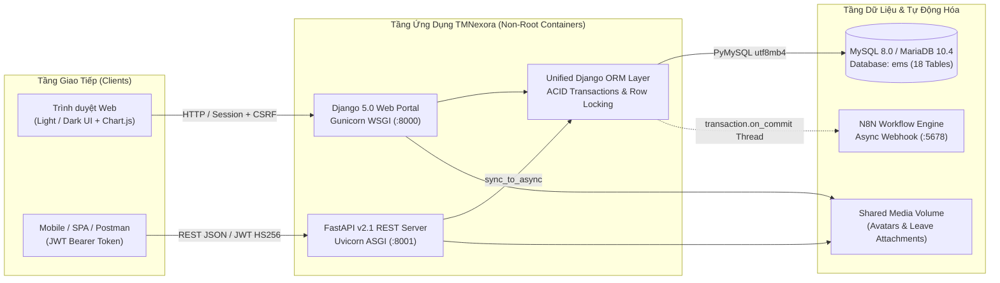

<div align="center">
  
  <h1>TMNexora — Enterprise Employee Management System (EMS)</h1>
  <p><strong>Hệ thống Quản trị Nhân sự Doanh nghiệp Toàn diện với Kiến trúc Kép (Django SSR Web Portal + FastAPI Microservice), Phân quyền RBAC 4 Tầng, Tự động hóa N8N và Triển khai Cloud-Native (Docker &amp; Kubernetes)</strong></p>

  <p>
    
    
    
    
    
    
  </p>
</div>

---

## 📑 Mục lục

1. [Tổng quan hệ thống](#-1-tổng-quan-hệ-thống)
2. [Kiến trúc tổng thể](#-2-kiến-trúc-tổng-thể)
3. [Công nghệ sử dụng](#-3-công-nghệ-sử-dụng)
4. [Các phân hệ nghiệp vụ cốt lõi](#-4-các-phân-hệ-nghiệp-vụ-cốt-lõi)
5. [Ma trận phân quyền RBAC 4 tầng](#-5-ma-trận-phân-quyền-rbac-4-tầng)
6. [Thiết kế Cơ sở dữ liệu (18 Bảng)](#-6-thiết-kế-cơ-sở-dữ-liệu-18-bảng)
7. [Tài liệu RESTful API (FastAPI & OpenAPI)](#-7-tài-liệu-restful-api-fastapi--openapi)
8. [Cấu trúc thư mục dự án](#-8-cấu-trúc-thư-mục-dự-án)
9. [Hướng dẫn cài đặt & khởi chạy](#-9-hướng-dẫn-cài-đặt--khởi-chạy)
   - [9.1. Môi trường Local (Windows / Linux / macOS)](#91-chạy-trên-môi-trường-local-development)
   - [9.2. Triển khai bằng Docker Compose (MySQL + Web + FastAPI)](#92-triển-khai-bằng-docker-compose-all-in-one)
   - [9.3. Triển khai trên Kubernetes Cluster](#93-triển-khai-trên-kubernetes-cluster)
   - [9.4. Tích hợp tự động hóa N8N Webhook](#94-tích-hợp-tự-động-hóa-n8n-webhook)

---

## 🌟 1. Tổng quan hệ thống

**TMNexora** là nền tảng Quản trị Nguồn nhân lực Doanh nghiệp (*Enterprise Employee Management System*) bao phủ trọn vẹn vòng đời nhân sự từ định biên tổ chức, hồ sơ nhân viên, chấm công thời gian thực, luồng phê duyệt nghỉ phép 2 cấp, động cơ tính lương tự động theo chuẩn Luật Lao động & Thuế TNCN Việt Nam, đánh giá hiệu suất (KPI) đến báo cáo điều hành trực quan.

Hệ thống được thiết kế theo mô hình **Hybrid Dual-Runtime**:
- **Django 5.0 Web Portal (`:8000`)**: Giao diện quản trị Server-Side Rendering tốc độ cao, hỗ trợ **Popup CRUD Modal** thao tác mượt mà không cần tải lại trang, tìm kiếm nhanh (`Ctrl + K`) và chuyển đổi giao diện **Light / Dark Mode** chống chớp sáng (FOUC-free).
- **FastAPI Enterprise REST Server (`:8001`)**: Dịch vụ ASGI bất đồng bộ hiệu năng cao cung cấp **48 HTTP Operations** chuẩn OpenAPI 3.1 (`/docs`), xác thực **JWT Bearer (`HS256`)**, kiểm soát xung đột dữ liệu bằng giao dịch **ACID (`transaction.atomic` + `select_for_update`)** và gắn `X-Request-ID` truy vết từng request.

---

## 🏗 2. Kiến trúc tổng thể



---

## 🚀 3. Công nghệ sử dụng

| Tầng kiến trúc | Công nghệ & Thư viện | Vai trò trong dự án |
| :--- | :--- | :--- |
| **Web Core (SSR)** | `Python 3.12+`, `Django 5.0.8`, `Gunicorn 22+`, `WhiteNoise 6.6+` | Xử lý giao diện Web MVT, quản trị session, nén Gzip/Brotli và gắn hash tài nguyên tĩnh. |
| **RESTful API (ASGI)** | `FastAPI`, `Uvicorn`, `Pydantic v2`, `PyJWT`, `asgiref` | Cung cấp REST API bất đồng bộ, kiểm tra dữ liệu đầu vào nghiêm ngặt và tự sinh Swagger UI. |
| **Cơ sở dữ liệu** | `MySQL 8.0` / `MariaDB 10.4+` (`PyMySQL`, `cryptography`), `SQLite3` | Lưu trữ dữ liệu quan hệ chuẩn `InnoDB` (`utf8mb4`), khóa ngoại toàn vẹn & hỗ trợ môi trường kiểm thử. |
| **Giao diện (UI/UX)** | `HTML5`, `CSS3 Custom Design System`, `Vanilla JS`, `Chart.js`, `Lucide Icons` | Thiết kế đáp ứng (Responsive), biến màu động Dark/Light Mode, biểu đồ phân tích và Popup Modal. |
| **Xuất báo cáo & Xử lý tệp** | `openpyxl`, `XlsxWriter`, `pandas`, `Pillow`, `Unidecode` | Xuất bảng lương & báo cáo điều hành ra Excel đa trang tính, xử lý ảnh đại diện và chuẩn hóa chuỗi tiếng Việt. |
| **Tự động hóa** | `N8N Workflow` (`requests` + `threading` + `on_commit`) | Đẩy thông báo phê duyệt nghỉ phép, phát hành phiếu lương và cảnh báo hệ thống qua Webhook bất đồng bộ. |
| **DevOps & Cloud-Native** | `Docker Multi-Stage`, `Docker Compose`, `Kubernetes (K8s)` | Đóng gói container non-root (`UID 10001`), điều phối đa dịch vụ và giám sát sức khỏe qua `/healthz/`, `/readyz/`. |

---

## 🧩 4. Các phân hệ nghiệp vụ cốt lõi

1. **Tài khoản & Xác thực (`apps/accounts`)**
   - Mở rộng mô hình `AbstractUser` với trường `role` 4 cấp (`admin`, `hr`, `manager`, `employee`).
   - Hỗ trợ đăng nhập linh hoạt bằng **Username** hoặc **Email doanh nghiệp**, tự động khóa phiên truy cập đối với nhân sự có trạng thái `inactive`.
2. **Hồ sơ Nhân viên (`apps/employees`)**
   - Quản lý thông tin cá nhân, ảnh đại diện, ngày gia nhập, phòng ban, chức danh và người quản lý trực tiếp (`self-referencing FK`).
   - **Thuật toán cấp phát Mã nhân viên tự động theo cấp bậc**:
     - Cấp Chủ tịch / Phó Chủ tịch HĐQT: Mã 4 chữ số thuần túy (`0001`, `0002`, ...).
     - Các khối/phòng ban chuyên môn: Tiền tố định danh kết hợp số thứ tự 4 chữ số (`BOD`, `BGD`, `KT`, `HR`, `FIN`, `SAL`, `MKT`, `LEG`, `RND`, `ADM` — ví dụ: Trưởng phòng `KT0001`, nhân sự tiếp theo `KT0002`...).
3. **Cơ cấu Phòng ban & Chức danh (`apps/departments`)**
   - Cây tổ chức đa cấp đệ quy (`parent_id`) tích hợp thuật toán chống vòng lặp phân cấp (*Cyclic Hierarchy Guard*).
   - Quản lý trưởng đơn vị, ngân sách hoạt động (`budget`), thống kê biên chế thực tế và danh mục chức danh chuyên môn (`Position`).
4. **Chấm công Thời gian thực (`apps/attendance`)**
   - Điểm danh **Check-in / Check-out** trực tuyến ràng buộc duy nhất theo cặp `(employee, date)`.
   - Tự động phân loại trạng thái ca làm việc: `present` (<= `08:30`), `late` (> `08:30`), `remote` (làm việc từ xa), `absent`.
   - Tự động tính số giờ tăng ca (`overtime_hours`) khi thời điểm Check-out vượt mốc kết thúc ca chuẩn (`17:30`).
5. **Đơn Nghỉ phép & Quy trình Duyệt 2 Cấp (`apps/leave`)**
   - Hỗ trợ 4 loại phép: Nghỉ phép năm (`annual`), Nghỉ ốm (`sick`), Việc riêng (`personal`), Nghỉ không lương (`unpaid`) kèm tệp minh chứng đính kèm.
   - Tự động kiểm tra tính hợp lệ của khoảng ngày và tính `duration_days`.
   - **Máy trạng thái phê duyệt 2 cấp**: `pending` -> Trưởng phòng duyệt cấp 1 (`approved_manager`) -> Ban Nhân sự / Admin phê duyệt chính thức (`approved`) hoặc từ chối (`rejected`), tự động bắn thông báo phản hồi ở từng chặng.
6. **Động cơ Tính lương & Bảo mật Phiếu lương (`apps/payroll`)**
   - Tự động tổng hợp tổng số giờ OT trong tháng từ bảng `Attendance` để tính lương làm thêm giờ theo hệ số **150%** (dựa trên định mức `22 ngày * 8 giờ = 176 giờ/tháng`).
   - Tự động trích nộp bảo hiểm bắt buộc **10.5%** (`BHXH 8% + BHYT 1.5% + BHTN 1%`) và tính **Thuế TNCN lũy tiến từng phần 7 bậc** (từ `5%` đến `35%` sau giảm trừ gia cảnh bản thân `11.000.000 VNĐ`).
   - Tự động kết chuyển `gross_salary`, `net_salary` và gửi thông báo ngay khi phiếu lương chuyển sang trạng thái `paid`.
7. **Đánh giá Hiệu suất — KPI (`apps/performance`)**
   - Thiết lập kỳ đánh giá (ví dụ: `Q1 2026`, `Q4 2026`), chấm điểm năng lực thang `0 - 100`, lưu trữ lịch sử người đánh giá (`reviewer`) và nhận xét chuyên môn.
8. **Trung tâm Thông báo & Webhook (`apps/notifications`)**
   - Phân loại thông báo theo danh mục và 4 mức độ ưu tiên (`low`, `normal`, `high`, `critical`), hỗ trợ đánh dấu đã đọc từng mục hoặc toàn bộ.
   - Kích hoạt luồng nền bất đồng bộ gửi payload JSON sang **N8N** sau khi giao dịch CSDL đã `commit` thành công.
9. **Báo cáo Điều hành & Thống kê (`apps/reports`)**
   - Tổng hợp chỉ số biên chế, tỷ trọng nhân sự theo phòng ban, biến động quỹ lương thực chi, tình hình chuyên cần và xuất báo cáo Excel chuyên nghiệp.

---

## 🔐 5. Ma trận phân quyền RBAC 4 tầng

| Phân hệ / Quyền hạn | `Admin` | `HR` | `Manager` | `Employee` |
| :--- | :---: | :---: | :---: | :---: |
| **Quản trị tài khoản & hệ thống** | Toàn quyền (CRUD + Xóa cứng) | Không | Không | Không |
| **Hồ sơ nhân viên** | Toàn công ty (CRUD + Xóa) | Toàn công ty (Xem, Thêm, Sửa) | Xem & cập nhật nhân sự thuộc phòng ban quản lý | Chỉ xem hồ sơ cá nhân |
| **Phòng ban & Chức danh** | Toàn quyền (CRUD + Xóa) | Xem, Thêm, Cập nhật | Xem cơ cấu tổ chức | Xem cơ cấu tổ chức |
| **Chấm công** | Toàn công ty (CRUD) | Toàn công ty (CRUD & Hiệu chỉnh công) | Xem bảng công phòng ban + Check-in/out cá nhân | Check-in/out & xem lịch sử cá nhân |
| **Nghỉ phép (Luồng 2 cấp)** | Toàn quyền & Duyệt cuối | Xem toàn bộ & **Duyệt cấp 2 (`approved`)** | Xem phòng ban & **Duyệt cấp 1 (`approved_manager`)** | Tạo đơn, sửa/hủy đơn `pending` cá nhân |
| **Bảng lương (Bảo mật lương)** | Toàn công ty (CRUD + Xóa) | Toàn công ty (Tính lương, Duyệt chi `paid`) | **Chỉ xem phiếu lương của chính mình** | **Chỉ xem phiếu lương của chính mình** |
| **Đánh giá hiệu suất (KPI)** | Toàn công ty (CRUD) | Toàn công ty (CRUD) | Lập & cập nhật đánh giá KPI nhân sự trong phòng | Xem kết quả KPI cá nhân |
| **Báo cáo & Thống kê** | Toàn bộ báo cáo & Xuất Excel | Toàn bộ báo cáo & Xuất Excel | Xem báo cáo tổng hợp | Không truy cập |

---

## 🗄 6. Thiết kế Cơ sở dữ liệu (18 Bảng)

Cơ sở dữ liệu `ems` gồm **18 bảng** tuân thủ chuẩn toàn vẹn tham chiếu (`PK`, `FK`, `UNIQUE`, `1:1`, `1:N`, `N:M`), chia thành:
- **9 Bảng Thực thể Nghiệp vụ (Domain Entities)**: `accounts_user`, `departments_department`, `departments_position`, `employees_employee`, `attendance_attendance`, `leave_leaverequest`, `payroll_payroll`, `performance_performancereview`, `notifications_notification`.
- **3 Bảng Trung gian Kết hợp (`N:M` Associative Tables)**: `accounts_user_groups`, `accounts_user_user_permissions`, `auth_group_permissions`.
- **6 Bảng Hệ thống Phi thực thể (Django Infrastructure Tables)**: `auth_group`, `auth_permission`, `django_admin_log`, `django_content_type`, `django_session`, `django_migrations`.


> 📄 Xem chi tiết đặc tả DDL SQL đầy đủ tại: [`Data Analysis/EMS_SQL_Full_Specification.sql`](Data%20Analysis/EMS_SQL_Full_Specification.sql).

---

## 🔌 7. Tài liệu RESTful API (FastAPI & OpenAPI)

Dịch vụ FastAPI (`fastapi_main.py` & `apps/api_routers.py`) cung cấp **9 nhóm OpenAPI Tags / 26 URL Paths / 48 HTTP Operations** tại `http://127.0.0.1:8001/docs`:

| Nhóm API (Swagger Tag) | Các Endpoint chính | Mô tả chức năng |
| :--- | :--- | :--- |
| **1. Xác thực** | `POST /api/auth/login`<br>`POST /api/auth/refresh`<br>`GET /api/auth/me` | Đăng nhập nhận cặp `access_token` & `refresh_token`, làm mới phiên JWT và lấy hồ sơ người dùng hiện tại. |
| **2. Nhân viên** | `GET, POST /api/employees/`<br>`GET, PUT, DELETE /api/employees/{emp_id}` | Truy vấn danh sách theo phạm vi RBAC, khởi tạo đồng thời `User + Employee` (Atomic) và tự sinh mã nhân viên. |
| **3. Phòng ban & Chức danh** | `GET, POST /api/departments/`<br>`GET, PUT, DELETE /api/departments/{dept_id}`<br>`GET, POST /api/positions/`<br>`GET, PUT, DELETE /api/positions/{pos_id}` | Quản lý cây phòng ban (kiểm tra chống vòng lặp cha-con), quân số trực thuộc, ngân sách và định biên chức danh. |
| **4. Chấm công** | `POST /api/attendance/check-in`<br>`POST /api/attendance/check-out`<br>`GET, POST /api/attendance/`<br>`GET, PUT, DELETE /api/attendance/{att_id}` | Điểm danh vào/ra ca thời gian thực (tự tính đi muộn & giờ OT sau `17:30`) và quản lý bảng công cho HR/Admin. |
| **5. Nghỉ phép** | `GET, POST /api/leaves/`<br>`GET, PUT, DELETE /api/leaves/{leave_id}`<br>`POST /api/leaves/{leave_id}/approve`<br>`POST /api/leaves/{leave_id}/reject` | Tạo đơn nghỉ phép, tự tính `duration_days` và thực thi phê duyệt 2 cấp (`Manager` -> `HR/Admin`). |
| **6. Bảng lương** | `GET, POST /api/payrolls/`<br>`GET, PUT, DELETE /api/payrolls/{payroll_id}` | Tính lương tự động (OT `150%`, Bảo hiểm `10.5%`, Thuế TNCN 7 bậc), phát hành lương `paid` và bảo mật phiếu lương. |
| **7. Đánh giá hiệu suất (KPI)** | `GET, POST /api/performance/`<br>`GET, PUT, DELETE /api/performance/{review_id}` | Lập phiếu chấm điểm KPI định kỳ theo thẩm quyền quản lý và tra cứu lịch sử đánh giá. |
| **8. Thông báo** | `GET, POST /api/notifications/`<br>`PATCH /api/notifications/{notif_id}/read`<br>`POST /api/notifications/read-all`<br>`DELETE /api/notifications/{notif_id}` | Quản lý hộp thư thông báo cá nhân, đánh dấu đã đọc hàng loạt và kích hoạt N8N Webhook. |
| **9. Báo cáo & Thống kê** | `GET /api/reports/summary` | Báo cáo điều hành tổng hợp quân số, tỷ trọng phòng ban, chuyên cần trong ngày và tổng quỹ lương thực chi. |
| **Health Probes** | `GET /healthz/`, `GET /readyz/` | Đầu dò Liveness & Readiness (`SELECT 1` tới MySQL) phục vụ Docker & Kubernetes. |

---

## 📁 8. Cấu trúc thư mục dự án

```text
HeThongQuanLyNhanVien/
├── apps/                           # Các phân hệ nghiệp vụ cốt lõi
│   ├── accounts/                   # Custom User Model, Auth & Quản lý tài khoản
│   ├── attendance/                 # Chấm công thời gian thực & tính OT
│   ├── departments/                # Cây phòng ban đa cấp & Chức danh (Position)
│   ├── employees/                  # Hồ sơ nhân sự, Dashboard & cấp mã tự động
│   ├── leave/                      # Đơn nghỉ phép & luồng phê duyệt 2 cấp
│   ├── notifications/              # Trung tâm thông báo & N8N Webhook trigger
│   ├── payroll/                    # Động cơ tính lương, BHXH 10.5% & Thuế TNCN
│   ├── performance/                # Đánh giá hiệu suất làm việc (KPI)
│   ├── reports/                    # Báo cáo thống kê & Xuất tệp Excel
│   └── api_routers.py              # Modular FastAPI Routers & Pydantic v2 Schemas
├── config/                         # Cấu hình trung tâm Django (settings, urls, wsgi, asgi)
├── frontend/                       # Giao diện người dùng & Tài nguyên tĩnh
│   ├── static/                     # Design System CSS, JS (Theme, Modal, Command Palette), Logo
│   └── templates/                  # Giao diện HTML5 hỗ trợ đầy đủ Light / Dark Mode
├── k8s/                            # Manifests triển khai Kubernetes (Namespace, Deployment, Job...)
├── scripts/                        # Các kịch bản khởi tạo dữ liệu mẫu (seed_employees, seed_payroll...)
├── Data Analysis/                  # Sơ đồ UML Class/ERD, đặc tả SQL & tài liệu phân tích nghiệp vụ
├── fastapi_main.py                 # Điểm khởi chạy dịch vụ FastAPI Enterprise REST Server (:8001)
├── manage.py                       # Công cụ quản trị dòng lệnh Django (:8000)
├── Dockerfile                      # Multi-stage Production Dockerfile (Non-root UID 10001)
├── docker-compose.yml              # Điều phối 3 container: MySQL (db) + Django (web) + FastAPI (api)
├── docker-entrypoint.sh            # Script kiểm tra DB, tự động migrate & chạy Gunicorn/Uvicorn
├── DOCKER_KUBERNETES.md            # Hướng dẫn vận hành chuyên sâu cho Docker & Kubernetes
├── n8n-workflow-notification.json  # Mẫu cấu hình Workflow tự động hóa thông báo trên N8N
├── .env.example                    # Mẫu khai báo biến môi trường chuẩn
└── requirements.txt                # Danh sách thư viện Python cho Local & Production
```

---

## ⚙️ 9. Hướng dẫn cài đặt & khởi chạy

### 9.1. Chạy trên môi trường Local (Development)

**Yêu cầu tiên quyết:** `Python 3.12+` và `MySQL 8.0+` / `MariaDB 10.4+` (XAMPP hoặc MySQL Server, đã tạo sẵn database trống tên `ems` với bảng mã `utf8mb4`).

**Bước 1 — Tạo môi trường ảo & cài đặt thư viện:**
```powershell
# Windows PowerShell
python -m venv venv
.\venv\Scripts\Activate.ps1
pip install -r requirements.txt
```

**Bước 2 — Cấu hình biến môi trường (`.env`):**
```powershell
Copy-Item .env.example .env
```
Mở tệp `.env` và hiệu chỉnh thông số kết nối MySQL phù hợp với máy của bạn (ví dụ với XAMPP mặc định: `DB_NAME=ems`, `DB_USER=root`, `DB_PASSWORD=`, `DB_HOST=127.0.0.1`, `DB_PORT=3306`).

**Bước 3 — Khởi tạo bảng CSDL & tài khoản Quản trị viên:**
```powershell
python manage.py migrate
python manage.py createsuperuser
```
*(Tùy chọn)* Nạp dữ liệu nhân sự và bảng lương mẫu bằng các script trong `scripts/` nếu cần thử nghiệm nhanh.

**Bước 4 — Khởi chạy song song Giao diện Web và RESTful API:**

* **Terminal 1 — Django Web Portal:**
  ```powershell
  python manage.py runserver 8000
  ```
  -> Truy cập giao diện quản trị tại: **`http://127.0.0.1:8000/`**

* **Terminal 2 — FastAPI Enterprise REST Server:**
  ```powershell
  python fastapi_main.py
  ```
  -> Truy cập tài liệu tương tác Swagger UI tại: **`http://127.0.0.1:8001/docs`**

> 💡 **Cách thử nghiệm nhanh trên Swagger UI (`/docs`)**: Mở `POST /api/auth/login` -> nhấn **Try it out** -> nhập tài khoản của bạn -> nhấn **Execute** để nhận `access_token` -> bấm nút **Authorize** ở góc trên bên phải và dán mã token vào để mở khóa toàn bộ 9 nhóm API.

---

### 9.2. Triển khai bằng Docker Compose (All-in-One)

Hệ thống tích hợp sẵn tệp `docker-compose.yml` tự động dựng đồng bộ **3 container** kết nối nội bộ và kiểm tra sức khỏe tự động:

```powershell
docker compose up -d --build
docker compose ps
```

| Service | Container | Cổng truy cập (Host) | Vai trò & Healthcheck |
| :--- | :--- | :--- | :--- |
| **`db`** | `tmnexora-mysql` | `localhost:3307` -> `3306` | MySQL 8.0 (`utf8mb4`), lưu trữ bền vững trên volume `mysql_data`. |
| **`web`** | `tmnexora-web` | `http://127.0.0.1:8000` (hoặc `:8080`) | Tự động chạy `migrate` và khởi chạy Gunicorn WSGI (`/readyz/`). |
| **`api`** | `tmnexora-api` | `http://127.0.0.1:8001/docs` | Khởi chạy FastAPI Uvicorn ASGI kết nối trực tiếp vào `db` (`/readyz/`). |

---

### 9.3. Triển khai trên Kubernetes Cluster

Toàn bộ cấu hình Namespace, ConfigMap, Secret, MySQL Dev Stateful, Migration Batch Job, RollingUpdate Deployment (2 Replicas, Non-Root `10001`) và ClusterIP Service được đặt tại thư mục [`k8s/`](k8s/):

```powershell
kubectl apply -f k8s/namespace.yaml
kubectl apply -f k8s/configmap.yaml
# Sao chép k8s/secret.example.yaml thành k8s/secret.yaml và cập nhật khóa bí mật trước khi apply
kubectl apply -f k8s/secret.yaml
kubectl apply -f k8s/mysql-dev.yaml
kubectl apply -f k8s/migrate-job.yaml
kubectl apply -f k8s/deployment.yaml
kubectl apply -f k8s/service.yaml
```

> 📘 Xem hướng dẫn chi tiết từng bước vận hành, kiểm thử tải và xử lý sự cố container tại [`DOCKER_KUBERNETES.md`](DOCKER_KUBERNETES.md).

---

### 9.4. Tích hợp tự động hóa N8N Webhook

1. Khởi chạy **N8N** (mặc định tại `http://localhost:5678`).
2. Chọn **Import from File** trong N8N và nạp tệp [`n8n-workflow-notification.json`](n8n-workflow-notification.json).
3. Kích hoạt Workflow (**Active**) và gán đường dẫn Production Webhook vào biến `N8N_WEBHOOK_URL` trong tệp `.env`. Khi phát sinh sự kiện duyệt đơn nghỉ phép, thanh toán lương hoặc gửi thông báo quản trị, hệ thống sẽ tự động đẩy dữ liệu sang N8N mà không làm chậm phản hồi của người dùng.

---

<div align="center">
  <p>Phát triển bởi <strong>TrMinh</strong> • Dự án Hệ thống Quản trị Nhân sự Doanh nghiệp <strong>TMNexora (EMS)</strong></p>
</div>
